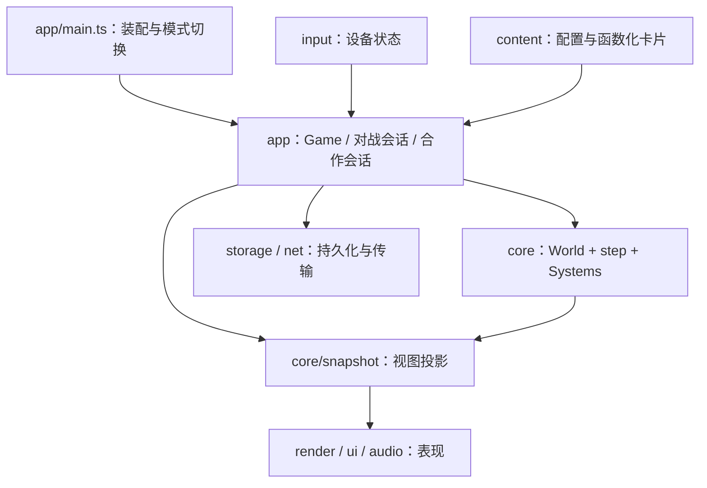
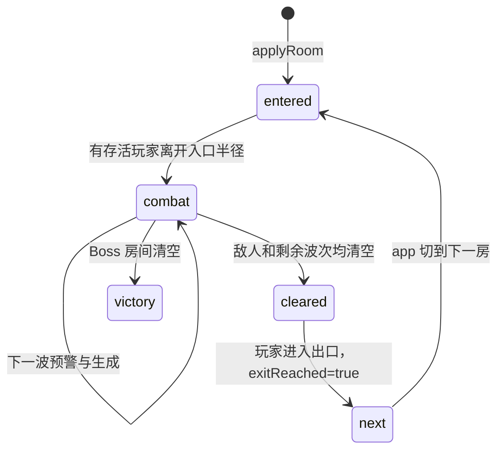

# PRISM 技术手册 1/3：架构、数据结构与模拟流程

本手册依据 **2026-11-04 核对的源码**编写，代码基线为 [`828c4a9eed139ee7a54b1f7786c536680a07306f`](https://github.com/what20360/prism/tree/828c4a9eed139ee7a54b1f7786c536680a07306f)。它描述该版本**实际如何运行**；后续改代码时，需要同步维护相应章节。文中的源码链接相对于本目录，可在 GitHub 直接打开；函数名、类型名是进一步搜索的入口。

| 分册 | 内容 |
|---|---|
| **本篇** | 项目结构、依赖方向、世界与实体、逻辑时钟、每 tick 顺序、空间算法、快照与确定性 |
| [2. 战斗、内容与模式](02-combat-content-and-modes.md) | 属性与购卡、三类武器、伤害、地雷、AI/Boss、关卡集、闯关/无尽/测试/合作/1v1 |
| [3. 客户端、存储、联机与维护](03-client-storage-network-and-development.md) | 浏览器装配、输入、渲染、声音、菜单、预购、存档迁移、网络协议、测试、构建、实现边界 |

推荐先读本篇第 1–7 节，再沿第二篇选择具体机制，最后读第三篇了解浏览器与外部数据。已有 [需求规格](../requirements.md) 表达玩法意图，[数值表](../balance.md) 记录平衡规则，[架构设计](../architecture.md) 保留早期方案与后续补充；遇到历史段落、注释与代码不同，本手册明确指出，不把原计划当成已实现功能。

## 1. 技术路线与整体结构

PRISM 是 **TypeScript + Vite + Canvas2D + 原生 DOM + WebAudio + WebRTC** 的浏览器游戏，没有 React、物理引擎或运行时第三方依赖。TypeScript、Vite、Vitest、ESLint 均属于开发依赖；生产游戏使用浏览器 API。TypeScript 严格选项见 [tsconfig.json](../../tsconfig.json)，构建与测试入口见 [package.json](../../package.json)。

它采用“可变世界数据 + 按顺序执行的系统函数”。`Actor` 是统一结构，玩家、一般敌人、对战玩家和蜘蛛通过阵营、行为与状态字段区分。这不是带有组件注册表、查询器、调度器的通用 ECS，也不是以继承树组织的角色类系统。



箭头表示主要调用或数据流，不是逐项穷尽的 import 图。尤其 `ui` 与 `render` 会使用内容表来生成文字和颜色，网络验证器也会引用应用层存档/预设校验；**强约束主要落在 core 不反向依赖外层**。

### 1.1 各目录负责什么

| 目录 | 职责 | 典型实现 |
|---|---|---|
| `src/app/` | 装配、浏览器循环、会话生命周期、存档/预设协调 | [main.ts](../../src/app/main.ts)、[game.ts](../../src/app/game.ts) |
| `src/app/modes/` | 规则不同的模式状态机、模式私有随机流与计时 | [endless.ts](../../src/app/modes/endless.ts)、[duel.ts](../../src/app/modes/duel.ts)、[coop.ts](../../src/app/modes/coop.ts) |
| `src/core/` | 世界类型、几何、属性管线、序列化、一次固定模拟步 | [world.ts](../../src/core/world.ts)、[simulation.ts](../../src/core/simulation.ts) |
| `src/core/systems/` | 移动、锁定、武器、伤害、地雷、AI 等具体状态变换 | [weapons.ts](../../src/core/systems/weapons.ts)、[damage.ts](../../src/core/systems/damage.ts) |
| `src/content/` | 玩家/怪物初值、卡片公式、难度、模板、旧规则表与说明 | [cards.ts](../../src/content/cards.ts)、[levelSets.ts](../../src/content/levelSets.ts) |
| `src/input/` | 键鼠、触屏与按键配置，输出意图所需的原始状态 | [keyboard.ts](../../src/input/keyboard.ts)、[touch.ts](../../src/input/touch.ts) |
| `src/render/canvas2d/` | Canvas 场景、镜头、HUD、武器配色 | [renderer.ts](../../src/render/canvas2d/renderer.ts) |
| `src/ui/` | DOM 页面、菜单、卡片浏览、结算、边缘购买提示 | [menu.ts](../../src/ui/menu.ts)、[homeMenu.ts](../../src/ui/homeMenu.ts) |
| `src/audio/` | 根据视图变化合成音效和背景音乐 | [audio.ts](../../src/audio/audio.ts) |
| `src/net/` | 信令、数据通道分片、输入与世界包校验 | [peer.ts](../../src/net/peer.ts)、[protocol.ts](../../src/net/protocol.ts) |
| `src/storage/` | 浏览器配置与槽位的低层读写 | [config.ts](../../src/storage/config.ts)、[saveStore.ts](../../src/storage/saveStore.ts) |
| `tests/unit/` | Node 环境下的规则、回放、存档与模式测试 | [determinism.test.ts](../../tests/unit/determinism.test.ts) |
| `scripts/`、`.github/` | 单文件导出、构建版本信息、GitHub Pages 流程 | [build-offline.mjs](../../scripts/build-offline.mjs)、[deploy-pages.yml](../../.github/workflows/deploy-pages.yml) |

### 1.2 依赖隔离如何落实

`World.registry`、`World.economy`、`World.basePlayerAttrs` 由 app 把 content 的具体实现注入。因此 core 能在 Node 中运行，不需要构建页面。规则常量与纯配置函数也有一部分放在 [core/rules.ts](../../src/core/rules.ts)、[core/weaverRules.ts](../../src/core/weaverRules.ts)；并非所有数值都存于 content。

[eslint.config.js](../../eslint.config.js) 的 `no-restricted-imports` 限制 core 导入 app/ui/render/input/net/storage/content；[core-isolation.test.ts](../../tests/unit/core-isolation.test.ts) 另用源码扫描校验同一边界。它们验证的是 import 方向，不等于自动证明无任意副作用、无所有形式的间接 IO。

外层之间尚未划成严格单向依赖。例如合作引擎复用 `net/protocol.cleanAction`，合作协议复用 `app/modes/coop.readCoopSave`。分析或重构时，应区分“core 隔离已执行”和“整个项目都是严格分层”这两个命题。

## 2. 状态归属：哪些东西在哪里保存

`World` 是一间房当前战斗及局内成长的主要容器，但**不是一个完整会话的全部状态**。房间索引、对战比分、无尽补刷流、连接对象、UI 页面与购卡提示计时还在外层闭包中。

| 状态 | 拥有者 | 为什么不放在同一对象 |
|---|---|---|
| 实体、弹丸、雷、资源、战斗随机状态、房间状态 | `World` | 所有系统直接操作，能序列化和回放 |
| 当前闯关房间索引、重开次数、UI 模式 | `createGame` 闭包 | 负责流程编排，不是单房战斗规则 |
| 无尽层数、模式 RNG、待补刷 tick 队列 | `createEndlessMode` 闭包 | 无尽生成和普通核心解耦 |
| 对战轮次、准备、倒计时、胜场、经济刷新时刻 | `createDuelMatch` 闭包 | 这些状态决定何时调用核心 step |
| 合作席位、倒地/离线状态、房间人数快照 | `World.coop` | 影响核心复活、资源与团灭判定 |
| 合作配置、房间索引、各席位预购 | `createCoopMatch` 闭包及 `CoopSave` | 属于合作流程和存档封套 |
| 键按下集合、触点捕获、待消费右键事件 | 各 input 对象 | 属于设备采样，不是世界存档 |
| Peer、超时墙钟、消息序号、SDP、缓冲状态 | 会话及 `createDuelPeer` | 浏览器句柄不能作为游戏数据保存 |
| 菜单选页、折叠项、提示 DOM、镜头尺寸 | UI / Renderer | 展示状态通常不应影响战斗 |
| 已购买等级与实付账目 | 单人 `World` 或 `participants[id]` | 账目决定退款，不能从当前价格反推 |
| 有序购买计划与自动购买提示计时 | `PurchasePlan` + `createPurchaseQueue` 闭包 | 计划可保存，临时提示计时独立运行 |

这也解释了三种不同对象：`World` 是活的模拟状态；`WorldData` 是可序列化世界；`Snapshot` 是给绘制和表现消费的视图。对局存档还必须把 `WorldData` 和模式闭包的必要字段合起来。

## 3. World、实体与基础数据结构

完整类型在 [world.ts](../../src/core/world.ts)，基本几何类型与逻辑频率在 [types.ts](../../src/core/types.ts)。以下是按用途重组的说明，不是另一个需要同步维护的完整接口副本。

### 3.1 坐标、时间与数值约定

| 概念 | 表达 | 约定 |
|---|---|---|
| 位置/方向 | `Vec2 { x, y }` | 世界坐标通常按屏幕方向，x 向右、y 向下；方向不携带速度 |
| 障碍/边界 | `Rect { x, y, width, height }` | 轴对齐矩形，角色和弹丸主要是圆 |
| 速度 | `attrs.speed`、`bulletSpeed`、`Projectile.vel` | 世界单位/秒；每步乘 `TICK_DT` |
| 时间 | 多数字段以 `Ticks` 结尾 | 逻辑频率 60Hz；180 tick 约 3 秒 |
| 角度 | `aimAngle`、`burstAngle` 等 | 弧度；`atan2(y,x)` 对应世界坐标 |
| 实体引用 | `EntityId = number` | 世界内递增；不是跨存档、跨会话的全局 UUID |
| 阵营 | `player / enemy / neutral` | 多数命中系统以“不等于自身阵营”为敌对；neutral 不是默认无害 |

核心使用 JavaScript `number`，没有定点数物理。没有设计等级上限不等于数值无穷大可用：购卡检查安全整数、有限价格和有限属性，能量伤害还有 `finitePower` 表示范围保护。

### 3.2 World 的字段分组

| 分组 | 关键字段 | 作用 |
|---|---|---|
| 时钟与随机 | `tick, seed, rng` | 固定步计数、初始种子与当前 PRNG 状态 |
| 依赖与基线 | `registry, economy, basePlayerAttrs` | 运行时注入的函数表、经济系数和属性基准 |
| 房间与波次 | `room, pendingSpawns, waves` | 房间几何、延迟入场刷怪、剩余波次与预警 |
| 可命中实体 | `actors: Map<EntityId, Actor>` | O(1) 按 ID 查角色，稳定遍历当前角色集合 |
| 其他对象 | `projectiles, mines, pickups` | 经常整批过滤/追加的有序数组 |
| 表现 | `effects, floaters, traces` | 短期特效、飘字和瞬时能量轨迹 |
| 单人成长 | `purchases, shards, revivesUsed` | 单人钱包、购买和复活账目 |
| 多人成长 | `participants?: Record<number, PlayerProgress>` | 每个外控角色独立钱包与购买 |
| 合作 | `coop?: CoopState` | 在线席位、分配模式、复活计时等 |
| 运行条件 | `roomCleared, exitReached, gameOver, victory, paused` | 系统及流程层的推进依据 |
| 统计 | `score, stats, playerTookHit` | 击杀、核心命中、连击、伤害与承伤统计 |
| 规则开关 | `resourceDrops, monsterShardDrop, cardRestrictions` | 对战/合作注入的共享规则入口 |
| 编号 | `nextEntityId` | 角色、弹丸、地雷、资源共享一个编号域 |

`progressOf(world, actorId?)` 隐藏了钱包的两种表示：没有参战表或不传 actorId 时返回 World 自身；多人传入具体 actorId 时返回对应 `PlayerProgress`。多人成长不能通过修改 `world.shards` 给某位队员发钱。

### 3.3 Actor：属性和运行状态分开

`Actor.attrs` 是从基线和购买记录解析出的**永久属性**；`combatAttrs(actor)` 在此基础上临时叠加狂暴、冲刺、电击减速。临时状态到期后不需要“把原属性加回去”，避免反复激活造成乘数漂移。

| Actor 字段组 | 例子 | 意义 |
|---|---|---|
| 身份/定义 | `id, team, tier, behavior, hasCore, contactDamage, name` | 角色是什么；tier、AI 行为和有无核心彼此独立 |
| 生存/空间 | `attrs, pos, radius, hp, shield, alive` | 最大值在 attrs，当前 HP/盾单独保存 |
| 控制 | `intent, aimAngle, manualLockId, lockTargetId` | 本步意图、最近射向、手动和解析后的目标 |
| 武器 | `fireCooldownTicks, burstRemaining, burstTimer, burstAngle, laserTicks, laserTimer` | 一次连发和持续激光本身也有时间状态 |
| 技能 | `skillSlots, rageTicks, dashTicks, ...CooldownTicks, dashDirection` | 解锁可以很多，但装备槽固定两个 |
| 受伤/状态 | `iframesTicks, contactCooldownTicks, burn, shockTicks, outOfCombatTicks` | 受伤保护、近战门控、异常与脱战回复 |
| 寻路 | `navPath, navTimer, navGoal` | 缓存路径、刷新周期和用于判断重算的目标 |
| 特殊 AI | `phase, specialCooldownTicks, weaver, spider, bombTicks, windupTicks` | 普通 Boss、巢母、蜘蛛、自爆和蓄能状态 |
| 合作贡献 | `contributions?: Record<number,number>` | 对该目标造成的有效盾/血伤害，供击杀掉落分配 |

`createActor` 只负责实例化；它不会决定 AI 如何移动。AI 系统写意图，移动和武器系统再消费同一个 Actor。`getPlayer`/`tryGetPlayer` 返回的是**第一个仍存活的 player 阵营角色**，不是固定 ID 1，也不是“当前屏幕使用者”。多人视角必须传 viewerId，或明确用 `actors.get(id)`。

### 3.4 Projectile、Mine、Pickup

| 对象 | 决定未来逻辑的字段 | 容易误解之处 |
|---|---|---|
| `Projectile` | `ownerId, team, pos, prevPos, vel, radius, damage, penetration, pierceLeft, innerMult, travelLeft, hitIds` | `penetration` 是护甲穿透，`pierceLeft` 是可消耗命中层数，完全不同 |
| 弹丸扩展 | `targetId, homingTurn, cruiseSpeed, ricochet, blastRadius, pierceSpeedMultiplier, pierceRangeGain, resolvedTick` | 属性通常在发射时快照到弹丸，之后买卡不统一改写全部已飞出的弹 |
| 弹丸表现 | `rangeBudget, trail, segments` | 剩余/总射程控制配色，trail/segments 是轨迹反馈；hash 排除轨迹表现字段 |
| `Mine` | 四类半径、伤害/生命、`fuseTicks, fuseTotalTicks, pulsesRemaining, pulseCount, ownerId, team` | 引信 `null` 表示未触发，数字 0 与 null 不能混为一谈 |
| 地雷扩展 | `velocity, travelLeft, child, broodLevel, expiresAt, nestRole, fragments, ignoreBullets` | 母雷/子雷限额独立；巢母地雷带专用归属角色 |
| `Pickup` | `kind, pos, value, quantity?, ttl, ownerId?, contributions?, gainApplied?` | value 是面值，quantity 用于旧堆叠兼容；当前生成的碎片逐颗存在 |
| 短期表现 | `Effect, Floater, EnergyTrace` | 电弧/激光伤害即时结算，EnergyTrace 不是持续造成伤害的弹丸 |

Actor 存在 Map，而弹丸等存在数组，是针对当前访问方式的简单选择；当前没有空间网格、四叉树、对象池、SoA 或通用实体组件数据库。

## 4. 创建、切房与删除

### 4.1 createWorld 和 applyRoom 不是同一阶段

[world.ts](../../src/core/world.ts) 的 `createWorld`：创建基础容器 → 创建 player Actor → 初始化资源 → **直接实例化传入的 spawns** → 配置波次。初始 `room.phase` 为 combat。

[dungeon.ts](../../src/core/dungeon.ts) 的 `applyRoom`：删除 enemy Actor，保留玩家/成长 → 清弹丸、雷、资源、特效及能量轨迹 → 更新几何与元数据 → 将 spawns 放入 `pendingSpawns` → 配置波次 → 房间设为 entered → 重置玩家位置和部分临时状态 → 生成本房一次性资源。

两者差别是刻意存在的：普通切房需要等玩家离开入口安全距离才刷怪；测试场可以立即生成靶机。不能假设每次 createWorld 都会等待入场，也不能直接把完整房间模板当成运行时 RoomState。

### 4.2 房间推进



这是正常切房路径的概念图；next 表示切房请求而非 RoomPhase 值。初始创建可直接进入 combat，代码还定义 idle 供对战等模式使用；类型中的 exited 目前没有被 updateExit 写入。

- [entry.ts](../../src/core/systems/entry.ts)：入口激活半径为 140，合作时任何在线存活队员离开入口即可触发；`spawnPendingEnemies` 一次性实例化队列。
- [room.ts](../../src/core/systems/room.ts)：存在活敌人就不清场；剩余波次首次设 90 tick 预警，读完后刷下一波；只有所有波结束才开门。
- [exit.ts](../../src/core/systems/exit.ts)：玩家位置进入矩形出口后只设置 `exitReached=true`，实际换房由 app 决定。
- [game.ts](../../src/app/game.ts)：单人闯关在 frame 的逻辑补步循环**之后**处理切房；无尽在模式 afterStep 内处理；合作在 match.tick 内处理。这一调用层级差异会影响写流程测试的方式。
- 对战存在 participants 但没有 coop，`updateRoom` 会提前退出，由对战状态机管理胜负。

### 4.3 对象如何结束生命周期

角色死亡通常先把 `alive=false`，并不立即从 Map 删除。这样同一步后续碰撞能检查尸体，而波次、无尽补刷、巢母清理或模式重建再删除对象。合作玩家倒地/离线时必须保留席位和 Actor，供复活或重连。

弹丸用“当前批快照 + 存活 ID 集合 + 最后过滤”推进；过程中死亡弹幕可能向 `world.projectiles` 追加新弹。若直接以旧数组覆盖新数组，会吞掉同 tick 新增弹，这是 [projectiles.ts](../../src/core/systems/projectiles.ts) 保留非 initialIds 对象的原因。

地雷删除尽量通过 `removeMine`：巢母需要获知消失位置以派工蛛补雷。普通限额回收部分使用数组过滤，分析专用行为时要看调用路径，不能认为任意 splice 都会自动发通知。

## 5. 从设备输入到 Intent

接口在 [controller.ts](../../src/core/controller.ts)。输入源描述“想做什么”，而不是直接给坐标或扣血。

```ts
interface Intent {
  readonly move: Vec2;
  readonly aim?: Vec2;
  readonly fire?: boolean;
  readonly placeMine?: boolean;
  readonly skills?: readonly number[];
  readonly skill?: number;              // 兼容单槽输入
  readonly lockTarget?: number | null;
  readonly automaticFire?: boolean;
  readonly autoAim?: boolean;
  readonly autoPickup?: boolean;
}
```

这些可选值有实际语义：

| 字段 | undefined | null / false | 具体值 |
|---|---|---|---|
| `lockTarget` | 保持手动锁定 | null 清除手动锁定 | ID 请求锁定对应敌人 |
| `fire` | 核心武器不被此字段压制，可按 AI 规则开火 | false 明确禁止开火 | true 请求开火 |
| `aim` | 武器可寻找范围内敌人 | 无 null 分支 | 方向向量，不是鼠标世界坐标 |
| `autoPickup` | 默认允许磁吸 | false 关闭磁吸 | true 仍需有拾取半径属性 |

因此 `{move:{x:0,y:0}}` 或 `NO_INTENT` **不是严格意义上的“禁止开火的空输入”**。网络使用 `IDLE_INPUT`，显式带 `fire:false`。

单人 `game.playerIntent`、联机 [readIntent.ts](../../src/app/readIntent.ts) 合并键盘、触屏、鼠标与设置：触屏非零移动优先，瞄准优先触屏方向；鼠标 CSS 坐标通过 `viewToWorld` 转成世界方向；右键选择映射为一次性目标 ID。自动瞄准/扳机需要拥有对应属性、设置开启且有效射程内有可见目标，目标消失则回到手动输入。设置本身不会购买卡片。

## 6. 两种时钟与浏览器 frame

### 6.1 固定逻辑步长

[types.ts](../../src/core/types.ts) 定义 `TICK_RATE=60` 和 `TICK_DT=1/60`。`step(world,intents)` 每次只推进一个逻辑 tick，不接收真实墙钟。

[game.ts](../../src/app/game.ts) 的 frame 用 accumulator 消费浏览器帧间时间：

```text
elapsed = min(本帧墙钟差, 0.25秒)
accumulator += elapsed
只要 accumulator >= 1/60秒 且世界可运行：
    重新采样本逻辑步的玩家意图
    执行模式 beforeStep、step、模式 afterStep、预购
    accumulator -= 1/60秒
最后生成 Snapshot 并画一帧
```

暂停、结算与切换 UI 模式会清空累积量或重置 lastTime。恢复页面不补算离开期间所有逻辑，只最多接收单帧 0.25 秒的时间，避免后台恢复后瞬间推进很远。这意味着严重卡顿时会丢弃部分真实时间；逻辑秒并不保证总与墙钟秒一致。

### 6.2 单人、对战和合作的循环不同

| 场景 | 谁推进 step | 菜单对时间的影响 |
|---|---|---|
| 单人闯关/无尽/测试 | `game.frame` | home/menu 设置 `world.paused`，不补步 |
| 1v1 房主 | `duelSession.loop → match.tick` | 个人菜单发送/使用空输入，不暂停对手；比赛倒计时仍走 |
| 1v1 客机 | 不推进权威世界 | 上传意图，收到包后替换本地显示世界 |
| 合作房主 | `coopSession.loop → match.tick` | 房主可暂停全队；个人菜单只停本人的输入 |
| 合作客机 | 不推进权威世界 | 接收房主世界；全队暂停状态也由房主决定 |

固定步长是一种模拟调度方式；当前联机是房主权威状态同步，**不是所有客户端交换输入并锁步运行**。

## 7. 一次 step 的准确执行顺序

入口：[simulation.ts](../../src/core/simulation.ts) 的 `step`。顺序会改变结果，不能仅按注释里的旧“阶段编号”重排。

| 顺序 | 调用 | 主要作用与可观察影响 |
|---|---|---|
| 0 | `gameOver / paused` 检查 | 结束或暂停时直接返回 |
| 1 | `updateCoopRevives` | 检查在线队友、团灭与复活；必要时再次返回 |
| 2 | 应用外控 Intent | 跳过不存在/死亡角色；立即尝试布雷和各技能槽 |
| 3 | `updateTimers` | 状态伤害、技能/无敌冷却、脱战回复、连击、表现 TTL |
| 4 | `updateRoomEntry` | 入场后实例化 pendingSpawns |
| 5 | `updateAi` | 为非外控敌人写意图；巢母/蜘蛛也在这里分派 |
| 6 | `updateMovement` | 按本步移动/冲刺方向、临时速度移动 |
| 7 | `separateActors` | 两轮软分离，限制巢母留在核心区 |
| 8 | `updateTargetLocks` | 解析本步手动锁定与自动候选 |
| 9 | `updateWeapons` | 更新射击冷却、连发、激光脉冲，发射/即时命中 |
| 10 | `updateDeflectFields` | 移动前改变敌弹速度或夺取所有权 |
| 11 | `updateBoss` | 旧 boss 行为的半血强化与周期清弹，非巢母主状态机 |
| 12 | `updateProjectiles` | 追踪、除法减速、分段移动、沿途命中与墙面反弹 |
| 13 | `resolveHits` | 补处理尚未在本 tick 路径中结算的弹丸 |
| 14 | `resolveContactDamage` | 玩家接触近战伤害，采用独立门控/无敌检查 |
| 15 | `updateMines` | 移动手雷、触发引信、多段爆炸、破片与子雷 |
| 16 | `updatePickups` | 磁吸、接触拾取、合作分配 |
| 17 | `updateRoom → updateExit` | 波次、清场、开门/胜利、出口进入 |
| 18 | 表现数组裁剪、受伤后团灭检查 | effects 最多保留 512、floaters 1024；防止最后一人刚死亡却逃过团灭 |
| 19 | `world.tick += 1` | 完成一次模拟步 |

几个调试时重要的后果：

- 输入请求的主动技能先激活，随后 timer 会在本步递减一次，显示持续 tick 可能比直觉少 1；秒级说明以近似时长理解。
- 实体弹先经过力场，再移动；激光/电弧则在武器阶段即时结算，不能期待后续力场去弯曲它们。
- `updateProjectiles` 已做沿途命中，`resolvedTick` 防止 `resolveHits` 再扣一次生命。
- 地雷爆炸排在弹丸移动之后，因此不是在每一条弹丸子路径中都即时爆炸清弹。
- 燃烧在 timers 阶段就可能致死，后续所有系统都须检查 alive。

## 8. 移动、碰撞与寻路

### 8.1 角色移动

[movement.ts](../../src/core/systems/movement.ts) 使用按轴处理：尝试 x 位移、圆与墙重叠则拒绝这一轴，再尝试 y。这样能沿墙滑动，而不需要刚体引擎。每 tick 位移按半径拆成子步，减少高速冲刺穿墙；世界边界按角色半径内缩。

`separateActors` 对存活角色两两检测，最多两轮，每次仅施加有限推力并重新走墙体碰撞。player 与 player 不分离，所以合作队员之间可重叠。单人玩家通常不被普通敌人的软分离推走；多人中可移动的参战角色会参与推力。它是防重叠的局部修正，不是保证密集群体一定通畅的完整拥堵求解器。

### 8.2 几何工具

| 文件/函数 | 算法与用途 |
|---|---|
| [collision.ts](../../src/core/collision.ts) `circleIntersectsRect` | 最近点到圆心距离，判断圆与矩形是否真正重叠；相切不算穿入 |
| 同文件 `resolveSpawnPosition` | 最多四轮推离重叠墙、最后钳制到边界，修正内容出生点 |
| 同文件 `distanceToRay / distanceToSegment` | 核心命中、轨迹距离和可见性辅助 |
| [navigation.ts](../../src/core/navigation.ts) `segmentRect` | 沿坐标轴求进入/离开参数，返回首接触 t 和法线 |
| 同文件 `firstWallHit` | 枚举墙和外边界，挑最早接触，用于弹丸/手雷/激光 |
| 同文件 `hasLineOfSight` | 检查线段遮挡；有半径时还检查圆形角色的边角间距 |
| [raycast.ts](../../src/core/raycast.ts) `circleEntry` | 激光与圆的线段进入参数 |

出生修正是有次数限制的兜底，不是任意坏几何都能修好的证明；内容仍需要做出生点和通道可达测试。

### 8.3 可见图寻路

`findPath(room,from,goal,radius)`：直接可见时返回目标；否则建立起点、终点和墙角外扩候选点，移除越界/落墙点，在可见点对之间按欧氏距离松弛，选取累计代价最小的未访问节点，回溯路径。它是可见图上的 Dijkstra 风格搜索，没有栅格 A*。

普通敌人的路径写在 Actor 上，目标显著移动或 navTimer 到期才重算；可直接看到后续航点时删掉多余拐点。蜘蛛的 travel 采用相似机制，并额外消费已经靠近的航点。最近一次“卡墙”问题不能只查移速，还要查半径、合法切线、航点消费与重算条件。

复杂度方面，当前一般角色分离是 O(A²)，弹丸命中扫描约 O(P×(A+M))；可见图节点数随墙数增长，搜索会重复做可见性扫描。没有空间索引或全局导航图缓存。高层敌群、盘丝洞和多人弹幕的成本需要实测，不能仅凭固定 tick 推断手机能稳定 60 FPS。

## 9. Snapshot：逻辑到表现的边界

[snapshot.ts](../../src/core/snapshot.ts) 的 `toSnapshot(world,viewerId?)` 把逻辑类型投影成 `ActorView / ProjectileView / MineView / SkillView / Snapshot`：

- Actor 位置变成绘制用 x/y，技能冷却转换为秒，临时属性通过 combatAttrs 计算。
- 生成剩余射程比例、锁定标识、技能环所需字段、波次预警位置。
- 多人将 viewer 的角色排到 actors 第一位，并设置 `local`。对战 guest 看到的阵营会翻转，让本机角色始终表现为 player；合作不翻转友军阵营。
- 钱包选择对应参与者，HUD 不能读取单人的 world.shards。
- 合作成员数据复制给视图，角色名字可以从合作席位回填。

Snapshot **不是存档，也不是当前网络直接发送的唯一消息类型**。网络发的是 WorldData 加模式状态，客机恢复 World 后再生成 Snapshot。Snapshot 没有足够信息重建购买账目、RNG 或持续攻击状态。

多数视图字段标记 readonly，ActorView 等创建了新对象；部分几何、资源或效果字段仍可能引用 World 内对象。这是 TypeScript 的只读约定，不是整棵对象的运行时深冻结。Renderer/UI 不应修改收到的视图数据。

## 10. 随机、确定性与状态哈希

[rng.ts](../../src/core/rng.ts) 使用 mulberry32：一个 uint32 state，`nextFloat` 前进一次，`nextInt` 返回左闭右开整数。战斗随机用 `world.rng`；种子闯关在构建房间时有单独 RNG；无尽还有自己的生成 RNG，并按世界种子与层数混合后重建。

“同种子”只有在**模式、版本、初始化配置、随机调用顺序和输入序列也一致**时才有复现意义。增加一次随机抽样可能影响后面整个序列。音频里允许 Math.random 生成噪声，因为声音不回写模拟。

[hash.ts](../../src/core/hash.ts) 的 `hashWorld` 递归遍历未来相关字段，Actor 按 ID 排序、对象键排序，数字按 1e−6 精度量化后做 32 位 FNV 风格混合：

| 包含 | 排除或不在覆盖范围 |
|---|---|
| 角色、弹丸、雷、资源、RNG state、钱包、购买、波次、房间、统计、暂停/终局、合作成员状态 | effects、floaters、traces；递归中的 trail、segments、damageFlashTicks |
| World 中影响后续的已列字段 | 注入的 registry/economy 函数、模式闭包、网络序号、UI、真实时间 |

因此 hash 是回归定位工具，**不是密码学校验，也不是整个 Session 的完整指纹**。测试无尽必须同时比较 EndlessCheckpoint；测试对战还要看比分/阶段；测试预购要看 PurchasePlan 与队列行为。只比较两个 World hash 不能证明模式所有未来行为等价。

## 11. 最小阅读与实验路线

从 [tests/unit/combat.test.ts](../../tests/unit/combat.test.ts)、[determinism.test.ts](../../tests/unit/determinism.test.ts) 看如何在 Node 创建世界。一个最小实验应明确注入内容、保持输入可复现，必要时先调用 applyRoom 把敌人排到入场队列。

```ts
// 放在 tests/unit/ 下时使用的相对路径；示例不创建浏览器。
import { createWorld, getPlayer } from '../../src/core/world';
import { step } from '../../src/core/simulation';
import { hashWorld } from '../../src/core/hash';
import { CARD_REGISTRY } from '../../src/content/cards';
import { DEFAULT_ECONOMY } from '../../src/content/economy';
import { PLAYER_BASE_ATTRS } from '../../src/content/player';

const world = createWorld({
  seed: 42,
  registry: CARD_REGISTRY,
  economy: DEFAULT_ECONOMY,
  playerAttrs: PLAYER_BASE_ATTRS,
  room: {
    id: 'experiment', kind: 'safe',
    bounds: { x: 0, y: 0, width: 1000, height: 700 },
    walls: [], entry: { x: 500, y: 560 }, spawns: [], pickups: [],
  },
});
const id = getPlayer(world).id;
for (let i = 0; i < 60; i++) {
  step(world, new Map([[id, { move: { x: 1, y: 0 }, fire: false }]]));
}
console.log({ tick: world.tick, position: world.actors.get(id)!.pos, hash: hashWorld(world) });
```

本次实际运行该示例，输出 tick=60、position={x:830,y:560}、hash=37712a55。它在当前入口和基础速度下向右移动 330 单位；更换入口、速度或墙体后，碰撞可能限制最终位置。哈希不是跨版本稳定接口，测试应断言关心的规则，而不只断言“运行不报错”。

## 12. 修改入口速查

| 想改变什么 | 优先阅读 | 连带需要核对 |
|---|---|---|
| tick 顺序或角色动作时机 | simulation.ts、timers.ts | 全部武器/复活回放、网络模拟假设 |
| 角色公共字段 | world.ts、attrs.ts | 创建、快照、序列化、迁移、hash、内容基线 |
| 切房/刷怪时机 | dungeon.ts、systems/entry.ts、systems/room.ts | 单人 frame、无尽 afterStep、合作 tick |
| 卡墙与冲刺碰撞 | collision.ts、navigation.ts、systems/movement.ts | AI 航点、出生点、Boss 核心区约束 |
| 锁定、手动抖动、自动操作 | systems/targeting.ts、game.ts、app/readIntent.ts | Renderer 的当前相机换算、卡片解锁与网络授权 |
| HUD 数据、多人本机视角 | snapshot.ts、renderer.ts | viewerId、本机死亡后的观战、钱包来源 |
| 确定性回归 | rng.ts、hash.ts | 模式私有状态、非逻辑表现数据与随机调用顺序 |

## 13. 主要符号的源码声明位置

下面的行号按本手册代码基线生成，点击可跳到声明。未来增删代码后行号可能漂移；符号名仍是检索依据。

| 符号 | 源码声明 |
|---|---|
| `World` | [src/core/world.ts:219](../../src/core/world.ts#L219) |
| `Actor` | [src/core/world.ts:27](../../src/core/world.ts#L27) |
| `Projectile` | [src/core/world.ts:89](../../src/core/world.ts#L89) |
| `Mine` | [src/core/world.ts:124](../../src/core/world.ts#L124) |
| `Pickup` | [src/core/world.ts:153](../../src/core/world.ts#L153) |
| `CoopState` | [src/core/world.ts:258](../../src/core/world.ts#L258) |
| `createWorld` | [src/core/world.ts:303](../../src/core/world.ts#L303) |
| `createActor` | [src/core/world.ts:387](../../src/core/world.ts#L387) |
| `Intent` | [src/core/controller.ts:7](../../src/core/controller.ts#L7) |
| `step` | [src/core/simulation.ts:27](../../src/core/simulation.ts#L27) |
| `applyRoom` | [src/core/dungeon.ts:16](../../src/core/dungeon.ts#L16) |
| `findPath` | [src/core/navigation.ts:46](../../src/core/navigation.ts#L46) |
| `toSnapshot` | [src/core/snapshot.ts:177](../../src/core/snapshot.ts#L177) |
| `hashWorld` | [src/core/hash.ts:3](../../src/core/hash.ts#L3) |
| `createGame` | [src/app/game.ts:146](../../src/app/game.ts#L146) |

下一篇：[战斗、内容与模式](02-combat-content-and-modes.md)。
