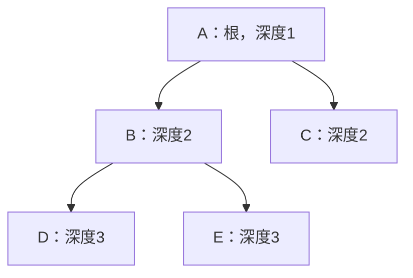
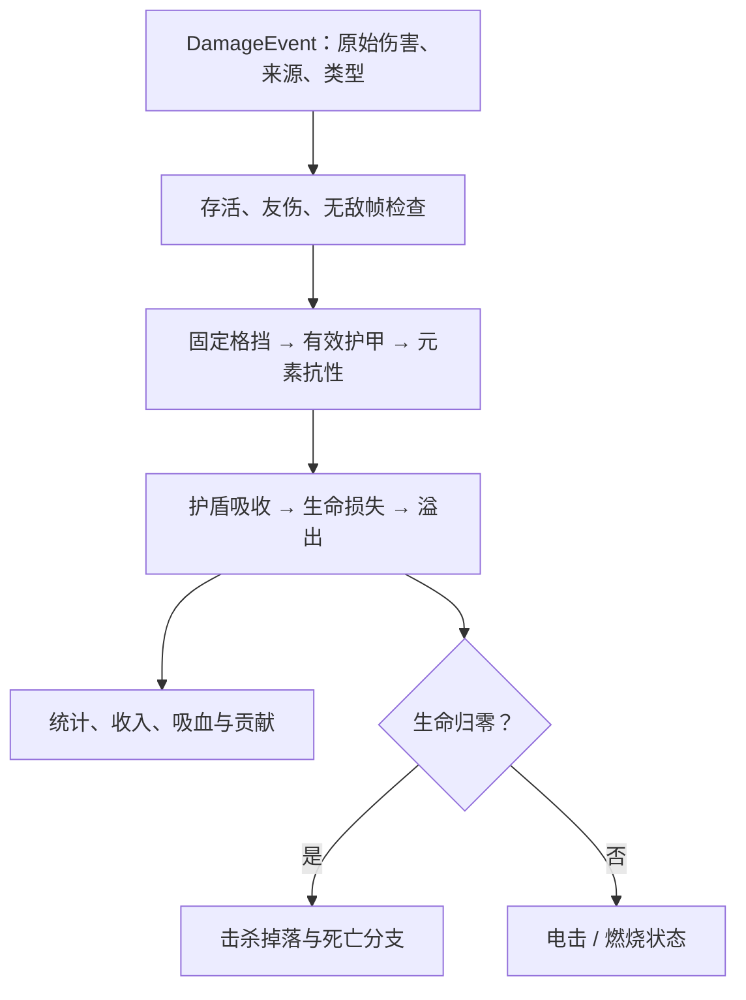
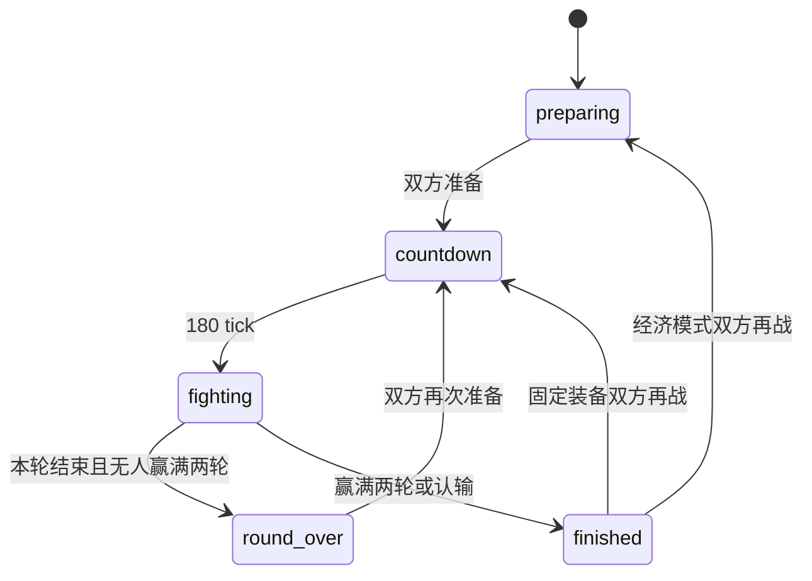

# PRISM 技术手册（二）：战斗、内容与模式

代码基线与日期同 [第一篇](01-architecture-and-simulation.md)：**2026-11-04 / `828c4a9e`**。本篇从“一个属性如何变成一次实际命中”展开，再介绍敌人、关卡及各模式。浏览器、存档和网络细节见 [第三篇](03-client-storage-network-and-development.md)。

**当前规则：v1.23（2026-11-04）。战斗迁移见[第四篇](04-sniper-combat-and-presentation.md)，服务器、身份与差量同步见[第五篇](05-server-and-replication.md)。基线链接用于追溯，当前实现以本分支源码为准。**

## 1. 内容定义如何进入核心

内容层主要输出普通对象和纯函数，不负责操作 DOM 或驱动逐帧循环。

| 内容 | 定义位置 | 消费位置 |
|---|---|---|
| 玩家基础 AttrSet | [content/player.ts](../../src/content/player.ts) `PLAYER_BASE_ATTRS` | createWorld、构筑解析、存档核验 |
| 敌人原型 | [content/enemies.ts](../../src/content/enemies.ts) `ENEMIES` | 闯关/无尽/测试/资源对战的生成器 |
| 怪物词条 | [content/monsterTraits.ts](../../src/content/monsterTraits.ts) | populateWave、rollEndlessEnemy、资源怪生成 |
| 卡片公式与注册表 | [content/cards.ts](../../src/content/cards.ts) | core/progress 与所有购卡 UI |
| 卡片用途/旧 ID 别名 | [content/cardRoles.ts](../../src/content/cardRoles.ts) | 卡片说明、迁移器 |
| 共享武器/技能/经济公式 | [core/rules.ts](../../src/core/rules.ts) | 内容描述与各系统共用 |
| 设计关卡集 | [content/levelSets.ts](../../src/content/levelSets.ts) | 闯关/无尽选图与盘丝洞测试 |
| 七档难度 | [content/difficulties.ts](../../src/content/difficulties.ts) | buildDungeon、主菜单、存档校验 |
| 对战规则 | [content/duel.ts](../../src/content/duel.ts) | createDuelMatch、协议校验和对战面板 |
| 冻结的旧卡表 | [legacyCards.ts](../../src/content/legacyCards.ts)、[legacyCardsV3.ts](../../src/content/legacyCardsV3.ts)、[legacyCardsV4.ts](../../src/content/legacyCardsV4.ts) | 只用于校验/迁移旧文件，不进入当前商店 |

“内容数据化”在当前代码里的准确含义是：换初值、公式或已有行为的组合通常改 content；增加一种完全新的武器、伤害机制或行为类型，仍需修改 core、序列化及测试，并不是加一条 JSON 就自动获得功能。

## 2. 卡片与永久属性管线

### 2.1 Card、Purchase 与 CardState 是不同层的对象

| 类型 | 来源 | 内容 |
|---|---|---|
| `Card` | [core/cards.ts](../../src/core/cards.ts)，由 content 创建 | ID、分类、优先级、价格函数、属性函数、描述、前置、禁购条件 |
| `Purchase` | 同文件，运行时放在世界/参战钱包 | `{id, level, paid?}`；记录累计等级与逐级实付 |
| `CardState` | [core/progress.ts](../../src/core/progress.ts) `listCardStates` | 某角色当前等级、下级价格、可购性、退款、前置、用途等只读 UI 数据 |

注册表 `CardRegistry` 对外提供 `get(id)` 与 `all()`。Card 含函数，不能放进存档；Purchase 才是重建构筑和核对退款的依据。

### 2.2 数值、描述、价格怎样从同一公式生成

[content/cards.ts](../../src/content/cards.ts) 定义 `Modifier = [key, operation, value, label, percent?]`，其中 operation 是 add/multiply/divide/set/chance。`formula(level)` 返回**该卡等级 n 的累计修改**。

- `formulaCard` 从 Modifier 构造 effectFn 和 summary，共用参数。
- `attrCard` 用于每级线性增加的普通属性。
- `numericCard` 对乘法采用 `value ** level`，对加法采用 `value * level`。
- `toggle` 使用 set 操作并设 `maxLevel=1`。
- `describe` 可以补充机制说明；`enabled` 可以保留卡片等级但在不适配的武器下暂停效果。

每一级价格：

$$
P(n)=\operatorname{round}(C\cdot 1.5^{n-1}).
$$

`C` 是首价，增长率来自 `CARD_ECONOMY.growth`。例如弹头强化首价 10，其累计属性是伤害 `+2n`；解析 Lv3 时是从基础上加 6，不是先加 2、再加 4、再加 6。

公式工厂每张卡处理后将最大生命至少夹到 1、护甲至少夹到 0。非常高等级下，这种逐卡夹取和浮点数范围也是实际语义；不能把所有极端组合都简化成没有边界的乘法表达式。

### 2.3 价格和属性结算使用不同“顺序”

`resolveAttrs(base,purchases,registry)` 从 base 的副本开始，把所有正等级记录按 **priority 升序、同值 ID 字典序**排列，逐卡 effectFn。

| 优先级 | 典型内容 | 设计作用 |
|---|---|---|
| 0 | 自动索敌、自动扳机 | 先激活功能属性 |
| 5 / 10 | 棱晶收益、普通枪械成长 | 基础属性增长 |
| 20 / 30 / 40 | 防御、恢复、备用核心 | 基础生存与复活属性 |
| 50 / 60 | 主动技能与强化回击 | 解锁与技能专精 |
| 90 / 91 | 电弧、激光主武器 | 先决定后续卡片使用哪种语义 |
| 100 | 狙击、追踪、雷场等 | 机制、姿态和中间变换 |
| 110 | 连发、霰弹 | 可以识别先前设置的一弹上限并转换效果 |
| 120 / 130 | 武器/多段雷/子雷专精 | 后置专精 |
| 1000 | 胆小鬼、玻璃大炮、棱晶契约 | 最后计算比例生命代价 |

这是属性结算顺序，不是“预设先买哪张”的顺序。玩家可以先买连发再买狙击，但最终属性仍按上述优先级重新解析。预设顺序见第三篇。

### 2.4 购卡事务与卖卡事务

[core/progress.ts](../../src/core/progress.ts) 的 `buyCard` 顺序是：

1. 查卡及当前等级；检查 maxLevel、模式禁购、unavailable、前置。
2. 计算下级价格，检查安全整数/有限数与钱包。
3. 预先解析 proposed purchases，检查 `isFiniteBuild`，失败时不扣款。
4. 扣款；购买记录写入本级**实际支付**价格。
5. `reapplyAttrs` 重算角色派生状态。

`reapplyAttrs` 不只替换 attrs：它同步半径、裁剪盾与生命、交付新增生命/盾量，限制已有雷和弹数，清除切武器时的持续激光/连发，整理技能槽。

卖出逐次撤回最高一级，取 paid 的末项计算退款：

$$
R=\max\left(0,\min\left(P_{\rm paid}-1,\lfloor0.6P_{\rm paid}\rfloor\right)\right).
$$

之后删除末级账目、等级归零则移除记录，再重新解析。前置主要限制购买，卖掉前置不递归删除已购买的专精；专精是否暂停由 enabled/当前属性判断。旧账目缺失时使用迁移器补齐冻结历史价格，不能用新价格回算过去支出。

### 2.5 武器兼容性与狙击手

主武器 `attrs.weapon`：0 为弹芯枪、1 为电弧、2 为激光、3 为狙击手。三个解锁卡均单级且相互排斥；专精依赖对应解锁，并在该武器下生效。`ALL_CARDS` 还包一层 unavailable，阻止购买当前无效的实体弹速、追踪、悬浮、贯穿推进和爆炸等组合。

狙击武器将伤害/射程分别乘2、弹速乘3，设置 `maxProjectiles=1`；动能狙击专精n级提供伤害×2ⁿ、攻速×0.5ⁿ、战斗移速×0.7ⁿ，并将命中速度按0.01n加入可获倍率的基础伤害。随后优先级 110 的连发和霰弹识别到该上限，各自改为伤害乘 $1+0.1n_{\rm card}$，不增加弹数、也不执行原来的代价。武器系统还会主动清空 burstRemaining，防止“上一颗消失后补发一颗”的延迟连发。

发弹统一走 `emitProjectile`，所以普通射击、连发和破片都检查一弹容量；它不是只在鼠标开火入口做限制。能量武器不创建相同的实体 Projectile，不应把这项容量误解为限制电弧节点或激光脉冲。

## 3. 锁定、瞄准与自动扳机

[systems/targeting.ts](../../src/core/systems/targeting.ts) 的 `updateTargetLocks`：

1. 有新的 lockTarget 请求则验证敌对且存活，设置 manualLockId。
2. 有有效手动锁定时优先保留，即使当前暂时不满足射击距离。
3. 普通敌人选范围内最近且无遮挡的敌对角色。
4. 玩家/外控角色按瞄准方向的角差、距离和 ID 选择；非自动状态只接受前方约 ±60°，自动状态可用全方向。
5. 对已有目标减去 0.08 弧度的角差评分，形成轻微滞后，减少相近目标跳变。

手动锁定成立并不意味着一定能打中：`resolveAimAngle` 的自动攻击还检查真正武器射程与视线。默认目标候选范围与攻击有效范围也不同，候选至少可搜索到 900。

[systems/weapons.ts](../../src/core/systems/weapons.ts) 在自动瞄准时优先使用有效 pinned target，否则最近可见目标；手动时使用 intent.aim。`automaticFire=true` 且 `fire=false` 会停止连发和持续激光，表达“已启用自动扳机，但当前无有效攻击目标”。客户端拥有卡片、设置与目标三者同时成立才进入自动状态。

移动时固定鼠标的抖动修复在客户端：每逻辑 tick 用**当前角色位置重算相机**再进行 viewToWorld，而不是沿用上一绘制帧的镜头。锁定评分滞后解决的是换目标抖动，坐标重算解决的是手动方向抖动，两者不同。

## 4. 实体弹的完整生命周期

相关文件：[weapons.ts](../../src/core/systems/weapons.ts)、[projectiles.ts](../../src/core/systems/projectiles.ts)、[hits.ts](../../src/core/systems/hits.ts)。

### 4.1 发射、连发和霰弹

武器冷却以 `round(60/fireRate)` tick 计，至少 1 tick。一次普通攻击通过 fireAt 发出 multishot 个方向，相邻方向间隔 0.12 弧度；同向连发记录 burstAngle，轮间隔 4 tick；连发末轮或激光结束时才启动完整普攻冷却。连发和霰弹分别决定时间轮数与每轮方向数，实体弹总数相乘，但受容量和运行预算限制。

`emitProjectile` 把当时的伤害、半径、穿透、核心倍率、追踪参数等复制进弹丸，从角色半径的一半位置出发，或使用破片指定原点。实体弹不是实时引用发射者当前伤害；买卡后大多数已飞出的弹不会随之重算。

### 4.2 追踪与慢弹

追踪等级 n>0 时，初速是最终 bulletSpeed 的 0.5，最高是 1.0，按实际已飞路径/初始半程线性恢复至原速，最大角速度：

$$
\omega(n)=1+0.6\sqrt n\quad\text{rad/s}.
$$

每一步把 desired−current 的差归一到 $[-\pi,\pi]$，再夹到 $\pm\omega\Delta t$。owner 仍活着时弹丸跟随 owner 当前 lockTargetId；owner 不在时可继续使用弹丸保存的目标 ID。

高速转向的几何半径近似 $v/\omega$，所以狙击高弹速自然降低急转能力。悬浮弹芯改变实体弹速与射程，使相同路径预算可飞行更久；这里没有额外的“飞剑武器类型”。

### 4.3 射程扣的是路径长度

每步预计移动量：

$$
s=\min\left(\text{travelLeft},\frac{\lVert vel\rVert}{\text{slowDivisor}}\Delta t\right).
$$

地雷减速区取覆盖敌方雷中的**最大倍率**，不把多个区域乘起来；实际位移除以该倍率，不直接永久降低 vel。转弯、墙面弹射的每段路程继续消耗 travelLeft。弹射改变方向并消耗一层 pierce，至少保留一层继续；每 tick 反弹子循环有 64 次预算。

贯穿推进在命中单位后仍剩穿透时触发：速度与最高速度乘 `1+0.12×等级`，剩余射程与总预算各加 `200×等级`。它可能延长真实存活时间，但仍是距离机制，没有改成定时销毁。

### 4.4 连续碰撞、命中顺序与再命中

每步不是只检测弹丸最终位置。`firstWallHit` 先限制到最早墙面，`resolveProjectilePath` 再求这段路径与圆形单位/雷体的 contactTime，按 t 再按 ID 排序命中。因此高弹速不会仅因为一帧跨过角色而漏掉碰撞。

`hitIds` 是“仍需要离开接触区的对象”，不是一生只能命中一次的历史集合。下一段开始时，若弹丸已离开该单位的重叠半径，就移除 ID；追踪或弹射回来可再次造成伤害，连续贴在同一对象上则不会逐帧刷伤害。

命中核心需要目标有 core 且至少两层穿透，并满足核心射线距离判定；普通命中耗 1 层，核心耗 2 层并乘 innerMult。护甲穿透 penetration 不在这里消耗。

弹丸与敌方地雷本体碰撞会扣雷 HP，并终止该弹；雷 HP 耗尽走 removeMine，不自动等价于完成一次爆炸。进入侦测范围则可启动引信，这是另一条路径。

### 4.5 爆炸与偏转

实体弹的 blastRadius 对主命中目标周围其他敌对角色追加一次伤害；当前这条溅射路径没有墙体视线检查。不能从激光的遮挡规则推断所有爆炸都会被墙挡住。

偏转包含两个实现：`updateDeflectFields` 对范围内敌弹加径向速度，主动期间夺取 team/ownerId、反向并调整速度；`hits.tryDeflect` 处理主动窗口内实际碰到角色的弹。它们都会清空 hitIds、转移奖励归属、更新追踪目标；高级偏转增加伤害。容量检查避免狙击手借反射同时持有多颗弹。

## 5. 电弧：独立的无环分叉树

实现：[energyWeapons.ts](../../src/core/systems/energyWeapons.ts) `fireElectric`，参数：[rules.ts](../../src/core/rules.ts) `arcProfile / arcHopRange`。

### 5.1 起点与拓扑

电弧没有要求敌人位于枪口正前方。先收集玩家射程 R 内、无遮挡、敌对且存活的候选，按锁定优先、瞄准角差、距离、ID 排序。multishot 选择多个不同起点，最多 64。

每个起点独立维护 nodes 数组、used 集合和 budget：

- `pierce` 决定总可命中的节点预算，根节点也算一次。
- `burstCount` 决定最大深度，根深度为 1；不是一定逐一延伸的链长。
- 从 nodes 的队首到队尾广度展开，每个节点可连接多个未访问敌人。
- 后续每条边距离不超过 `0.8R`，并单独检查视线。
- 同一树 used 排除重复节点，从而不成环；不同树的 used 不共享，可以攻击同一目标。
- 每树最多构建 64 个节点，属于执行预算，不是卡片等级上限。

若场上只有上述可达关系，命中花 5 层穿透；深度 2 的 B/C 衰减一致，深度 3 的 D/E 也一致，和数组里的访问先后无关。

### 5.2 衰减和余量如何分配

设专精等级 q，效率 $e=1+0.25q$：

$$
r=1-0.38/e,\qquad r_b=1-0.15/e,\qquad u=0.15e.
$$

节点先全部构建，再计算剩余穿透。由浅到深，每一层要按**该层节点总数**付费，付得起才强化这一整层；付不起就停止向深层强化。余下穿透 s 统一变成基础增伤：

$$
D_0=\operatorname{finitePower}\left(D(1+0.2q)(1+su)\right).
$$

某节点深度 d，有 k 条被强化的前置跨层，伤害为：

$$
D_d=D_0r_b^k r^{d-1-k}.
$$

以上图为例，若预算 7、实际只命中 5 个节点，剩余 2 恰好强化深度 2 的 B/C；D/E 的路径包含一次强化跨层和一次普通跨层。不会只强化 B 而让同深度 C 伤害更低。

电弧先构造拓扑再依序 applyDamage，画面只是为各边追加 EnergyTrace。每个根准备发射时若已死亡会跳过；没有起点时仍画一个短电流提示。穿透预算、深度预算、目标搜索范围三者要分别检查，排查“有连发但不传导”不能只看一项。

## 6. 激光：有持续时间的离散瞬发射线

实现同在 [energyWeapons.ts](../../src/core/systems/energyWeapons.ts) 的 `fireLaserPulse`；持续控制在 `weapons.updateLaser`。

一次攻击设置 `laserTicks = round(12×burstCount)`，每 6 tick 发一次伤害脉冲。每个脉冲重新追踪射线、重建本脉冲命中集合，不是画一条不动的线持续按渲染帧扣血。

| 属性 | 当前映射 |
|---|---|
| range | 实际激光路径预算 `1.8×range` |
| damage | 每脉冲 `0.3×damage×(1+0.1×laserPower)`，之后还要过格挡/护甲 |
| multishot | 射线数，最多 64，每条独立穿透预算 |
| burstCount | 延长本次照射 tick，不变成普通同向弹丸队列 |
| laserPower | 同时增加脉冲倍率，方向间隔为 `0.12/(1+0.2×等级)` |
| pierce | 每单位 1 层、核心 2 层，墙面折射另耗 1 层 |
| ricochet | 有足够剩余穿透才按墙面法线反射 |
| bulletSize | 改变射线命中宽容与表现宽度，不是实体飞行半径 |

每条射线找最早墙面，并按沿线圆进入参数排序单位；穿透耗尽截断终点。一次脉冲/射线的 hit 集合跨反射段共享，避免同一脉冲绕回来重复结算该单位；**下一脉冲会重建集合**，因此仍能持续造成多次伤害。单条射线最多 128 段。

名义脉冲数约为 `ceil(持续tick/6)`。估算无减伤 DPS 时，还需要攻击冷却、照射持续时间、射线实际命中数和各次固定格挡；不能直接把射速×持续时间×每帧伤害相乘。闪电的节点衰减、激光的脉冲格挡、实体弹的碰撞/路程都会让同一账面 damage 的实战不同。

## 7. 统一伤害、异常状态和经济

### 7.1 伤害流水线

入口：[systems/damage.ts](../../src/core/systems/damage.ts) `applyDamage`；纯计算：[attrs.ts](../../src/core/attrs.ts) `resolveDamage`。

设原始伤害 H、固定格挡 B、护甲 A、护甲穿透 P、相应抗性 T：

$$
H'=\max(0,H-\max(0,B))\cdot\frac{100}{100+\max(0,A-P)}\cdot\frac{100}{100+\max(-80,T)}.
$$

再依序计算：盾吸收 `min(shield,H')`；剩余进入 HP；有效伤害是盾吸收加实际生命损失；溢出是穿盾后伤害超过原有 HP 的部分。固定格挡作用于**每一次独立伤害**，因此小额多段/多弹受影响更大。

全部格挡或无敌挡掉时，不发放正常伤害收入、吸血或新异常。致死事件先执行击杀/死亡；非致死且不是 status 的命中才施加异常，避免燃烧递归点燃自己。

`applyDamage` 是战斗受伤的中心入口，但不是所有 HP/钱包写入的唯一位置：拾取、买卖、回复、出生、测试控制、复活和 Boss 自身献祭也会修改状态。重构时不能把文件头的早期注释理解为“只有此文件能写 HP”。

### 7.2 状态与保护

| 状态 | 写入/执行 | 实际规则 |
|---|---|---|
| 电击 | applyDamage → timers/combatAttrs | 45 tick 移速乘 0.8，重复命中刷新 |
| 燃烧 | applyDamage → updateTimers | 每 20 tick 一次、共 3 次，raw 为命中原始伤害的 15%；刷新保留较高 raw |
| 普通受伤保护 | applyDamage | 有生命损失才设置；未显式覆盖时 player 默认 30 tick、敌人 0 |
| 对战普通受伤 | 对战 createWorld / spawn | 双方显式 damageIframesTicks=0，独立弹丸/脉冲可分别伤害 |
| 近战门控 | resolveContactDamage | participants 的角色使用 contactCooldownTicks，避免接触伤害每 tick 刷屏 |
| 单人备用核心 | killActor | 消耗复活账目，约半血无盾、120 tick 保护并清附近弹 |
| 合作倒地复活 | core/coop.ts | 300 tick 倒计时、严格半血无盾、120 tick 保护；团灭立即失败 |
| 脱战回盾 | updateTimers | 不攻击/不布雷/无持续激光且距受伤超过约 3 秒后逐 tick 回复 |

### 7.3 伤害收入和击杀掉落是两条来源

[rewards.ts](../../src/core/systems/rewards.ts) 的基础伤害收入：

$$
S_{\rm offense}=(D_{\rm effective}+\lambda D_{\rm overkill})\times\text{tierRate}\times\text{chainMultiplier}.
$$

单人再乘收益与敌方 rewardMultiplier；承伤收入使用减伤前 raw×takenRate。连击上限由 chainCap 决定，超过 3 秒没击杀断连。对战普通命中不产生这条收入；资源对战靠补助、资源和怪物掉落，合作则调用共享分配函数。

击杀掉落在 [loot.ts](../../src/core/loot.ts) 与 `dropKillLoot`：

$$
p=0.1n+0.1D_{\rm overkill}+HP_{\rm monster,max}/1000.
$$

当前代码**未购买时 n=0 仍保留溢出和怪物生命两项**。晶片 p 乘怪物奖励倍率；血球不乘。`rollLootAmount` 先把期望夹到 625，整数部分确定掉落，小数部分做一次 Bernoulli。自爆不作为玩家击杀，不领取这类击杀卡奖励。

`packLoot` 按 625/125/25/5/1 贪心拆面值；它输出压缩的数量描述。真正生成使用 `looseLoot` 展开为逐颗 quantity=1；旧资源仍可带 quantity，拾取值为 value×quantity。因此 packLoot 的旧注释“合并实体”不能代表当前 spawnLoot 的最终行为。

`spawnLoot` 默认上限为单人 384、**所有带 participants 的场景（含合作）192**。生成前整包预留位置，优先回收有 TTL 的旧掉落；永久房间资源不能回收时可能不生成新包。拾取者收益在领取晶片时才应用一次，gainApplied 用来兼容旧存档。

## 8. 地雷、手榴弹、破片与子雷

实现：[systems/mines.ts](../../src/core/systems/mines.ts)、[mineLimits.ts](../../src/core/mineLimits.ts)、[systems/projectiles.ts](../../src/core/systems/projectiles.ts)。

### 8.1 一颗雷的状态与四种半径

| 字段 | 负责的机制 |
|---|---|
| bodyRadius | 弹丸击中实体雷体，伤害雷 HP |
| triggerRadius | 敌对角色或可触发子弹靠近，开始读引信 |
| slowRadius | 敌对弹丸位移减速，和爆炸/触发范围独立 |
| blastRadius | 爆炸伤害与清弹范围 |

放雷时按 ownerId 单独计母雷数量，满额移除最早母雷；世界另有 256 雷的执行预算。放下时把伤害、范围、引信、段数和子雷等级快照到 Mine，之后购卡一般不回写所有旧雷，但属性重算会执行限额整理。

绝缘雷壳使子弹既不启动 proximity 引信也不能击毁雷体，同时实际减速倍率为 `1+(原倍率−1)×0.65`。单位仍可触发它。

### 8.2 引爆和移动

`fuseTicks=null` 为待机；进入触发条件时设定总引信 tick，之后递减至爆炸。手榴弹有 velocity/travelLeft，沿释放时移动方向前进，静止时沿最近枪向；到距离或撞墙时开始引信，不直接当成普通弹丸飞行。

每个爆炸段都调用 applyDamage，并清除爆炸范围内敌方弹。普通玩家雷的范围伤害目前不检查墙；带 nestRole 的巢母雷额外检查视线，清弹也受遮挡。两条路径的遮挡规则不能互相代替。

### 8.3 多段、破片和子雷

多段等级 n：共 `1+floor(n)` 段，每段伤害除以 `1+0.45n`，间隔 8 tick。exploding 防止已开始多段爆炸的雷继续作为减速雷或普通可击毁实体使用。

最后一段结束才 `finishMine`：非子雷且有蜂巢等级则生成子雷；owner 仍活着时再用 `emitProjectile` 发碎片。碎片继承**释放时角色当前的实体弹构筑**，不只是使用母雷伤害，因此同样受狙击手一弹容量约束。

蜂巢等级 n 的继承比例为：

$$
c=0.4+\frac{0.35n}{n+3}.
$$

母雷释放 `floor(2n)` 颗子雷，伤害/耐久乘 c，范围半径乘 $\sqrt c$，减速超出 1 的部分乘 c，破片数向下取整。子雷 900 tick 到期、broodLevel=0，不能递归生成孙雷。

母雷上限为当前 mineLimit；子雷上限是母雷上限×(2+n)，再受世界预算限制。卖掉蜂巢模组会由 enforceMineLimits 撤回子雷，旧母雷结束时也检查 owner 当前蜂巢属性，不能借预先放雷绕过出售限制。

## 9. 主动技能：拥有、装备和使用

实现：[systems/skills.ts](../../src/core/systems/skills.ts)、[combat.ts](../../src/core/combat.ts)、[rules.ts](../../src/core/rules.ts)。

- 解锁由 deflectLevel/rageLevel/dashLevel>0 决定，Actor 始终只有两个 skillSlots。
- 新解锁的技能通过 reconcileSkills 自动装入空槽；没有空槽则只拥有，不自动挤掉原技能。
- equipSkill 不能装未解锁技能，不能同时在两槽重复同一技能；装到另一槽会交换相关槽位。
- 卸下技能结束相应持续效果，冷却字段不清零；卖掉最后一级技能会整理槽位。
- 激活消耗的是该技能自己的冷却，skillCooldownRate 缩短技能总冷却，不直接加速整个世界。

狂暴 5 秒内按等级提高枪/雷伤、护甲、攻速和吸血；冲刺约 0.22 秒沿输入方向、无移动则沿枪向，冷却约 1.4 秒。冲刺复用移动碰撞，不提供穿墙或无敌。技能具体数值和说明共用 profile/describe 函数，不需要 UI 另写一套公式。

## 10. 敌人原型、词条与普通 AI

### 10.1 原型不是行为枚举的一对一映射

[content/enemies.ts](../../src/content/enemies.ts) 当前有 **8 个原型键**（包括保留的旧 Boss），而工蛛/幼蛛由专用生成器创建，不在 ENEMIES 中独立列项。

| 键 | 名称 / 行为 | 机制 |
|---|---|---|
| drifter | 游荡者 / chase | 追逐接触伤害 |
| turret | 哨戒炮台 / turret | 固定位置远程射击 |
| warden | 核心守卫 / turret | 精英核心、盾、格挡、散射 |
| stalker | 游猎射手 / skirmish | 靠近后后撤/横移，并提前量瞄准 |
| bomber | 自爆体 / bomber | 追逐、近距离读秒、范围爆炸与死亡弹幕 |
| lancer | 灼线哨兵 / lancer | 预先蓄能锁定射线方向，再发激光 |
| boss | 棱镜之心 / boss | 保留的环形弹幕、半血强化与清弹逻辑 |
| weaver | 盘丝母巢 / weaver | 盘丝洞专用状态，见下一节 |

[monsterTraits.ts](../../src/content/monsterTraits.ts) 复制 attrs 后抽取不重复词条，避免污染共享原型。树皮增格挡/HP、减速、弱热；迅捷提升移动/攻速；重甲提升护甲/物抗；雷涌/炽热改变攻击类型和对应抗性；裂核启用自爆相关行为。威胁值影响词条数量/概率，Boss 不抽裂核。

普通 AI 在 [systems/ai.ts](../../src/core/systems/ai.ts)：跳过玩家阵营和 controlled 集合，participants 场景选最近敌对参战者；看不到目标时仍可寻路靠近。可见时用至多约 0.25 秒的线性提前量瞄准玩家移动方向。skirmish 根据距离后退或切向移动；lancer 在预警开始记下 windupAngle，蓄能完成后开火。

自爆由 `selfDestruct` 执行，和 `killActor` 的击杀路径分开。`releaseDeathBurst` 负责裂核/自爆相关死亡弹幕；普通接触伤害与自爆范围伤害也不是同一入口。应分别测试“被打死”和“读秒自爆”，避免重复发奖励或漏掉弹幕。

## 11. 盘丝洞：几何和巢母状态机

### 11.1 先设计可走地面，再求墙体补集

[levelSets.ts](../../src/content/levelSets.ts) 定义 300 宽通道、510×510 核心区和 SILK_PATH 折线路径；下侧右边入口。每段路径扩成地面矩形，`wallsOutsideFloor` 用所有矩形边界切分平面，扫描地面补集，并纵向合并相同跨度的墙段，最后生成核心碰撞能识别的普通 Rect[]。

这让地图设计和既有碰撞/寻路系统兼容，无需专用螺旋碰撞器。RoomDesign 额外携带 core、patrol、mineAnchors、exit、skipExit，分别供 AI、初始化、正常/无尽出口和视觉使用。

### 11.2 并行计时状态，不是一个线性攻击枚举

[systems/weaver.ts](../../src/core/systems/weaver.ts) 使用 `Actor.weaver: WeaverState`，常量在 [weaverRules.ts](../../src/core/weaverRules.ts)。雷库存、蜘蛛库存、弹幕轮次和移动目标同时更新，不能把所有行为简化成“闲置→射击→召唤”的单串状态。

| 子系统 | 状态与主要逻辑 |
|---|---|
| 初始化 | 第一次 updateWeaver 创建状态；两锚点放初始雷，安全巡游点放幼蛛 |
| 雷缓存 | mineStock 上限 3，每 360 tick 恢复 1；满库存时重置恢复计时 |
| 场上雷限额 | 最多 6；同时预留任务工蛛的位置，避免一边派工蛛一边直接放雷超额 |
| 补雷任务 | removeMine 记录 lostMines；库存满 3 才派工蛛；任务点在旧位置附近随机抖动 |
| 保护/进攻雷 | 预测未来约 0.35 秒来弹；半血前在脚下保护，半血后对可见范围内玩家投送移动雷 |
| 蜘蛛缓存 | 上限 6，每 240 tick 补 1，缺员且有库存时每 120 tick 补一只 |
| 半血一次性爆发 | phaseBurst 锁一次；立即补齐幼蛛，每只直接消耗最大 HP/36，自身至少留 1 HP |
| 扇形弹幕 | 600 tick 冷却，三波、每波三层39颗、速度0.72/1/1.28，波间 60 tick；前两波靠近、第三波后撤，临发射停步并追踪瞄准 |
| 核心区约束 | AI 目标夹在 RoomDesign.core 内，角色分离后再次限制巢母位置 |

半血献祭是自身资源代价，直接扣 HP，不走玩家伤害和击杀奖励。这是统一伤害入口之外的一项明确例外。

### 11.3 两种蜘蛛

工蛛使用 SpiderState.task/goal 前往补雷点，成功布雷后转巡游，45 秒寿命结束或任务中死亡时把待补点放回队列。幼蛛看到玩家后进入 pursuing，接近或追击中半血可冲刺一次；近距离开始独立引爆计时，读秒期间停步。

二者复用 travel 可见图路径，但有不同外观、任务字段和死亡机制。巢母死后其巢雷撤回、关联蜘蛛结束，不是让 Boss 战由无限孤立召唤物继续拖延。行为状态进入序列化和哈希，读档不应重置库存或重复触发半血爆发。

## 12. 闯关与设计关卡集

### 12.1 实际房间数量与两种构建入口

[content/dungeon.ts](../../src/content/dungeon.ts) 的 `legacyDungeon` 构造 **5×5 个房间，再额外追加 1 个最终盘丝洞，共 26 房，索引 0–25**。每组前五房为安全屋、三间战斗房和守卫房。最终 Boss 是额外房间；旧文字“25 房含最终 Boss”不符合当前代码。

`buildDungeon()` 无参数返回兼容旧存档的固定模板序列；`buildDungeon({seed,difficulty})` 按种子选择布局、构造敌群/词条与多波。主菜单新局使用后者。

### 12.2 难度曲线和生成步骤

`dungeonProfile(difficulty,depth)` 中 rank=difficulty−1、depth=房间索引/5。生命/伤害/攻速等通过 rank 与 depth 复合，数量系数和波数也随二者增加。第 1 档 profile 数值因子是基准值，但种子原型替换、词条与布局选择仍在执行，不能理解为所有新内容都关闭。

一般房间通过 pickLevelSet 选普通布局，再为每波 populateWave：复制/替换原型 → 难度缩放 → 选安全位置 → 加词条。出生点检查墙体、入口距离、已放敌人半径；运行时 spawnEnemy 还会做一次位置修正。

最终盘丝洞保留作者几何，难度放大巢母本体和雷属性；高难度先生成护卫波，最后一波才是巢母。清场预警和换波使用核心 WaveState，不让 UI 定时器负责刷怪。

安全屋用 `safeRoom`，尺寸 1000×700，资源在进入时一次生成，减少切房之间的收集距离。关卡集当前有折光回廊、交错屏障、四柱工坊、盘丝洞；普通闯关选图限制 kind=combat，最终盘丝洞固定追加。

## 13. 无尽：层数分布、尾部与补刷

实现：[app/modes/endless.ts](../../src/app/modes/endless.ts)。它保存 floor、seed、专用 rng、population、respawned、spawnQueue，不在 step 中硬编码无尽分支。

### 13.1 每层生成

基础数量：

$$
N(f)=4+\lceil2\sqrt f\rceil.
$$

合作再乘该房在线人数倍率并向上取整。生成流按 `(seed XOR imul(floor,0x9e3779b1)) >>> 0` 派生；因此该层内容不依赖上一层打了多少发子弹。生成器选地图、随机原型与各属性、词条和一次性资源，再用 applyRoom 排入入场队列。

各基础属性以 $g^{f-1}$ 增长，例如生命 1.18、伤害 1.13、护甲 1.09、格挡 1.08，移动和攻速增速更缓。额外随机因子采用形状参数 2.5 的有限均值 Pareto 尾部，具体属性再取不同幂、原型偏置及 0.8–1.2 抖动。这是“平均强度随层指数提高”的构造，不是所有怪都共享同一个精确均值公式。

### 13.2 清场层与开放层

| 层 | 生成/通关 | 数值/奖励 |
|---|---|---|
| f%5≠0 | 初始有限群，清空后开门，不持续补刷 | 因子与加完词条后的关键属性均做层数上界检查 |
| f%5=0 | 入口阶段就有跳层出口；死亡敌人约 60 tick 后补刷 | 不用层数强度上界；第 k 次补刷奖励为 `(1+k/population)^−2` |

开放层仍有 JavaScript 有限数表示保护，并非允许 Infinity。蜘蛛等召唤物不进入普通死亡补刷队列，否则巢母召唤会把敌群数量无限抬高。

从第 5 层起选图池可包含盘丝洞，有限层也可能抽到；该地图在无尽中强制使用 kind=combat，以免清场直接判整局胜利。其巢母按层属性缩放，有限层限制基础战斗数值；开放层额外保留可跳过出口。

`EndlessCheckpoint` 保存 floor、rngState、respawned、spawnQueue；World 同时保存当前怪物和资源。恢复从两部分共同继续，不重新抽当前层或再发一批入场资源。

## 14. 测试模式：复用机制但隔离进度

实现：[app/modes/practice.ts](../../src/app/modes/practice.ts)，UI：[sections/practice.ts](../../src/ui/sections/practice.ts)。PracticeMode 有 initialize、beforeStep、afterStep、action、state 等钩子，通过 Game 装配复用核心。

- 可选靶机/敌人演练、开阔/掩体/盘丝洞、原型、数量、生命、护甲、格挡等。
- 自由购卡通过 credit 补钱包；直接设定等级调用 resolveAttrs/reapplyAttrs，允许绕过一般购买前置，但检查功能卡等级与有限构筑。
- 无敌通过 beforeStep 维持保护 tick；靶机 afterStep 可恢复死亡目标。
- DPS 使用 world.stats.damageDealt 差值，最近 180 tick 的伤害除以 3；平均 DPS 是测量起点后的总伤害/逻辑秒。开始不足 3 秒时，最近 DPS 仍除以完整 3，不是短窗口瞬时值。
- 场景重置清世界统计、实体与 RNG；计量重置只重设计量基线；两种重置不能混为一谈。
- 测试场 checkpoint 返回 null，不写普通闯关/无尽进度。

## 15. 合作规则：同阵营、多钱包和倒地

模式引擎：[app/modes/coop.ts](../../src/app/modes/coop.ts)；核心共享机制：[core/coop.ts](../../src/core/coop.ts)。网络对象不进入引擎，真实连接映射见第三篇。

### 15.1 席位与世界

最多 5 个 CoopMember，每人对应一个 player Actor 和 participants[id] 钱包，新人各有 200。hostId 是承担房主视角的席位 ID，不保证永远是 1；任何成员保存的快照都可让该成员在载入后成为新房主。

首次 start 要求在线成员全部准备、至少一人存活；只暂停再继续不要求重新走首次准备。restart 保留 ID、连接状态与房间规则，重建世界/钱包/构筑，其他队员需重新准备。

每房记录在线人数 N，普通敌人与每波按 `ceil(基础普通怪数×(1+0.7(N−1)))` 追加，上限预算 200；只有 Boss 的波保持一只，额外每名玩家加两名护卫。中途掉线不删除已生成怪，迟加入者等下一房更新数量。无尽用同倍率缩放基础群，并保存 roomPartySize。

### 15.2 倒地、离线和团灭

死亡玩家不立即删除，而是 alive=false、shield=0、reviveTicks=300；每逻辑 tick 检查还有在线活队友才读秒。复活找队友/入口附近相对安全点，恢复最大 HP 的一半、无盾、保护 120 tick，清异常和持续攻击。暂停不读秒，离线者不计活队友。

step 末再做一次团灭检查，避免最后一人刚在该步死亡后仍继续等待复活；已开始比赛的最后一个存活队友断线也立即按在线全灭处理。

disconnect 保存 offlineHp/offlineAlive，角色设为不存活、HP=0；重连恢复保存状态，仍是倒地者继续剩余倒计时，不凭空回满血。载入时只有导出视角的 hostId 在线，其他成员离线，世界暂停等待邀请。

### 15.3 四种资源分配

设在线人数 N、基础均分比例 b、各队员对该敌人有效伤害 $c_i$，总贡献 C。

| 模式 | 分配 |
|---|---|
| equal | 每在线队员基础份额 1/N |
| killer | 击杀掉落只允许所属击杀者拾取；环境掉落开放；所有者离线后释放 |
| free | 由当前拾取者领取，不共享 |
| damage | C>0 时 $w_i=b/N+(1-b)c_i/C$；C=0 时全部均分 |

默认 b=0.25。贡献只统计真实盾/血损失，不统计溢出或友伤；受害者上的累计贡献在击杀时复制到掉落，环境资源通常没有贡献表。

晶片基础总量先分配，各角色再乘自己的 shardGain 一次，在线倒地者也能收晶片。血球在 equal/damage 下只治疗在线存活、需要治疗的队员，未用完治疗在正权重且仍缺血者间再分配；满血成员可代为拾取。killer/free 的血球只治拾取者。离线成员不分享资源。

一次命中的即时伤害经济使用该次伤害贡献进行分配；击杀资源则使用该怪完整贡献表。二者都调用 resourceWeights，但不是取同一份贡献数据。

### 15.4 当前实现边界

合作 save/protocol 的范围校验和预购提示参数存在已核实不一致，见第三篇“实现审阅”。这里描述的准备、刷怪、复活与分配不意味着五设备直连、所有终局存档或个人菜单自动购买行为都已完成端到端验收。

## 16. 1v1 规则状态机

模式引擎：[app/modes/duel.ts](../../src/app/modes/duel.ts)，规则类型：[content/duel.ts](../../src/content/duel.ts)。

代码枚举用 `round-over`；图中下划线只是节点显示。准备/倒计时阶段由外层 tick 控制，不照常运行整个战斗世界。

| 模式 | 初始构筑与收入 |
|---|---|
| fixed | 标准属性/技能相同，钱包 0，不能购买 |
| budget | 每回合各 600，自选构筑，无额外经济、资源、怪物，经济卡禁购 |
| resource | 每回合各 600，每 600 tick 各补 15，随机刷新资源和 neutral 怪物 |

两名参战者 Actor ID 为 1/2，原始阵营为 player/enemy；neutral 怪物对双方敌对。双方普通受伤保护为 0，防止弹幕多次命中被统一无敌帧吞掉。回合限时 7200 tick，死亡判胜，超时比 HP/最大 HP，平局不加胜场。

回合间重建世界，交换出生侧、重置钱包和构筑，保留有序预购计划。准备后购买锁定，战斗中经济模式仍可购买。对战不写单人存档，也没有当前比赛断线后的完整恢复格式。

## 17. 按机制定位实现和测试

| 主题 | 核心入口 | 主要回归 |
|---|---|---|
| 属性优先级、退款、技能槽 | cards.ts、progress.ts、systems/skills.ts | [progression](../../tests/unit/progression.test.ts)、[builds](../../tests/unit/builds.test.ts)、[cardAudit](../../tests/unit/cardAudit.test.ts) |
| 弹速、射程、弹射、核心命中 | systems/projectiles.ts、hits.ts | [ballistics](../../tests/unit/ballistics.test.ts)、[rehits](../../tests/unit/rehits.test.ts) |
| 电弧分叉/深度/穿透 | systems/energyWeapons.ts | [lightningTree](../../tests/unit/lightningTree.test.ts)、[weaponVariants](../../tests/unit/weaponVariants.test.ts) |
| 三类武器兼容与激光 | systems/weapons.ts、energyWeapons.ts | [arsenal](../../tests/unit/arsenal.test.ts)、[tuning](../../tests/unit/tuning.test.ts) |
| 多段雷、子雷、偏转 | systems/mines.ts、deflectField.ts | [mechanisms](../../tests/unit/mechanisms.test.ts)、[weaponVariants](../../tests/unit/weaponVariants.test.ts) |
| 伤害、格挡、掉落 | systems/damage.ts、loot.ts | [combat](../../tests/unit/combat.test.ts)、[loot](../../tests/unit/loot.test.ts) |
| 寻路与普通敌人 | navigation.ts、systems/ai.ts | [movement](../../tests/unit/movement.test.ts)、[mechanisms](../../tests/unit/mechanisms.test.ts) |
| 盘丝洞几何、完整补雷路径、半血时序 | levelSets.ts、systems/weaver.ts | [levelSets](../../tests/unit/levelSets.test.ts)、[weaver](../../tests/unit/weaver.test.ts) |
| 闯关、无尽、测试模式 | content/dungeon.ts、app/modes | [dungeon](../../tests/unit/dungeon.test.ts)、[endless](../../tests/unit/endless.test.ts)、[practice](../../tests/unit/practice.test.ts) |
| 合作资源、复活、断线、保存 | app/modes/coop.ts、core/coop.ts | [coop](../../tests/unit/coop.test.ts) |
| 1v1 回合、经济与公平规则 | app/modes/duel.ts、content/duel.ts | [duel](../../tests/unit/duel.test.ts) |

## 18. 主要符号的源码声明位置

下面的行号按本手册代码基线生成，点击可跳到声明。未来增删代码后行号可能漂移；符号名仍是检索依据。

| 符号 | 源码声明 |
|---|---|
| `formulaCard` | [src/content/cards.ts:26](../../src/content/cards.ts#L26) |
| `resolveAttrs` | [src/core/cards.ts:77](../../src/core/cards.ts#L77) |
| `buyCard` | [src/core/progress.ts:66](../../src/core/progress.ts#L66) |
| `sellCard` | [src/core/progress.ts:108](../../src/core/progress.ts#L108) |
| `reapplyAttrs` | [src/core/progress.ts:123](../../src/core/progress.ts#L123) |
| `emitProjectile` | [src/core/systems/weapons.ts:89](../../src/core/systems/weapons.ts#L89) |
| `updateProjectiles` | [src/core/systems/projectiles.ts:15](../../src/core/systems/projectiles.ts#L15) |
| `resolveProjectilePath` | [src/core/systems/hits.ts:24](../../src/core/systems/hits.ts#L24) |
| `fireElectric` | [src/core/systems/energyWeapons.ts:17](../../src/core/systems/energyWeapons.ts#L17) |
| `fireLaserPulse` | [src/core/systems/energyWeapons.ts:57](../../src/core/systems/energyWeapons.ts#L57) |
| `applyDamage` | [src/core/systems/damage.ts:40](../../src/core/systems/damage.ts#L40) |
| `updateMines` | [src/core/systems/mines.ts:43](../../src/core/systems/mines.ts#L43) |
| `updateWeaver` | [src/core/systems/weaver.ts:85](../../src/core/systems/weaver.ts#L85) |
| `buildDungeon` | [src/content/dungeon.ts:122](../../src/content/dungeon.ts#L122) |
| `wallsOutsideFloor` | [src/content/levelSets.ts:46](../../src/content/levelSets.ts#L46) |
| `createEndlessMode` | [src/app/modes/endless.ts:73](../../src/app/modes/endless.ts#L73) |
| `createPracticeMode` | [src/app/modes/practice.ts:49](../../src/app/modes/practice.ts#L49) |
| `createCoopMatch` | [src/app/modes/coop.ts:54](../../src/app/modes/coop.ts#L54) |
| `createDuelMatch` | [src/app/modes/duel.ts:22](../../src/app/modes/duel.ts#L22) |

上一篇：[架构、数据结构与模拟](01-architecture-and-simulation.md)；下一篇：[客户端、存储、联机与维护](03-client-storage-network-and-development.md)。
