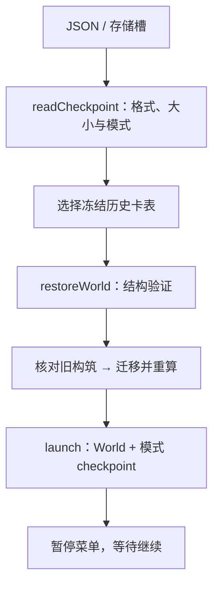
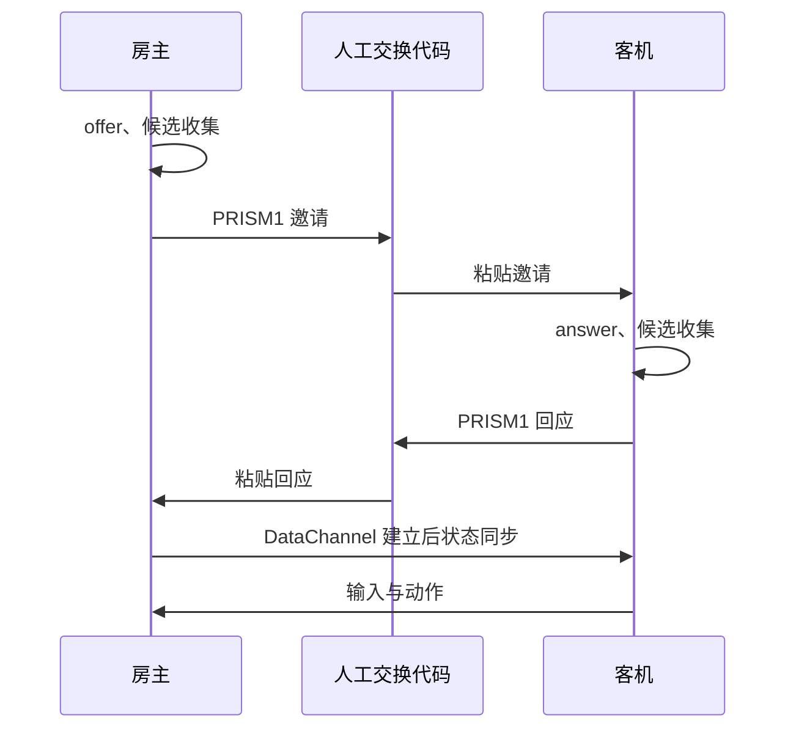

# PRISM 技术手册 3/3：客户端、存储、联机与维护

依据 **2026-11-04 核对的代码基线 `828c4a9e`**。架构、World 与 tick 顺序见 [第一篇](01-architecture-and-simulation.md)，武器与模式机制见 [第二篇](02-combat-content-and-modes.md)。本篇重点解释外层如何驱动核心，以及文件/网络数据如何安全地变成运行时对象。

## 1. 浏览器启动与会话生命周期

入口 HTML：[index.html](../../index.html)；模块装配：[app/main.ts](../../src/app/main.ts)。页面只需要 `canvas#game`，其余菜单和触控 DOM 由代码创建。

启动依次完成：

1. 创建 Canvas Renderer、键盘源、PointerSource、SettingsStore 与 AudioEngine。
2. 读取浏览器偏好，建立触屏控制；第一次 pointerdown/keydown 负责尝试解锁声音。
3. 创建 SaveManager、PlanManager、边缘 QuickBuy。它们通过回调获取当前会话，避免固定绑定到某个已经被替换的 World。
4. 创建主页、单人菜单和结算面板。
5. `launch('dungeon','home')` 先建立可绘制的单人世界，但处于 home，未正式开局，checkpoint 不应产生一个虚假的进行中存档。
6. 启动每 10 秒自动保存，以及 pagehide/visibilitychange 的保存回调。

### 1.1 launch 与模式切换

`launch` 在替换单人会话前尝试自动保存，再 dispose 旧 Game、清输入、关面板，组装 PracticeMode 或 EndlessMode，注入内容、种子、难度、快照和 UI 回调，最后 start 新 Game。

Game 的 `UiMode` 只有 play/menu/home。`setUiMode` 会清输入、清累积步长、重置购卡提示，再决定 world.paused。新 UI mode 通知 main 更新 DOM 可见性；结算则由 onRunEnd 单独打开 resultPanel。

进入联网时，`openDuel`/`openCoop` 保存并停止原 Game 的循环，创建一个独立网络 Session；离开时 dispose 对应 Session、重置输入、恢复主页和原 Game。这不是把所有模式都塞进一个永远运行的循环。

### 1.2 start、stop、dispose、restart 的区别

| 操作 | 单人 Game | 网络 Session |
|---|---|---|
| start | 开启 RAF 循环，重置墙钟/累积量 | 创建 Session 时启动自己的循环 |
| stop | 取消当前 RAF，不删除世界 | 会话关闭由 dispose 统一处理 |
| dispose | stop 并清意图集合；共享输入/渲染器归 main 管 | 取消 RAF、断开连接、删专属 DOM/监听、清输入 |
| restart | 新 World、清购买/预购和计量，保留设置；种子闯关/无尽保留种子 | 对战通过再战状态机；合作房主重建世界但保留席位 |

主页和暂停的切换不能只改 DOM hidden；如果世界 paused、输入按下状态、结算遮罩和帧时钟没有同时处理，就会出现“已重开但仍停在旧界面”等问题。[game.test.ts](../../tests/unit/game.test.ts) 以注入的假输入/Renderer 测试生命周期。

DEV 下 main 会暴露 `window.__prism` 读取当前单人 Game；生产构建不暴露。该调试入口不是稳定的游戏接口，也不能替代真实菜单/联网流程验收。

## 2. 输入：连续状态与一次性事件

### 2.1 键盘与绑定

[keyboard.ts](../../src/input/keyboard.ts) 用 pressed Set 记录持续按键，用 restartRequested/menuToggleRequested 记录每次按下仅消费一次的事件。keydown 忽略可编辑 DOM、Ctrl/Alt/Meta 快捷键和无关按键；blur/reset 清状态，避免窗口失焦后持续移动。

read 返回方向、布雷与技能槽；移动向量归一，避免斜向加速。consumeRestart/consumeMenuToggle 读取后清标志，重开只在结束画面等允许阶段触发。方向键作为移动备用，即使用户改了 WASD 绑定仍然接受。

[bindings.ts](../../src/input/bindings.ts) 单独保存 9 个动作的 KeyboardEvent.code，缓存于模块 current，持久化键是 `prism.bindings`。`setBinding` 拒绝重复键和不在允许代码集合中的输入；[sections/keys.ts](../../src/ui/sections/keys.ts) 负责下一次按键捕获、显示和重置。它不属于 ControlSettings 的版本化 JSON。

### 2.2 PointerSource

[pointer.ts](../../src/input/pointer.ts) 保存最新 viewport CSS 坐标、左键持续状态和 pendingLock。右键只排入锁定请求并禁止浏览器上下文菜单；触摸 canvas 是点选锁定，不在此处充当射击摇杆。pointerup、离开画布和 blur 释放扳机。

`reset()` 清射击和待锁定事件，但保留最近鼠标坐标，恢复菜单后仍可沿原指针瞄准。`consumeLock()` 的 undefined 与 null/具体位置有不同语义，最后由 app 映射成目标 ID。

### 2.3 触屏与快速点击

[touch.ts](../../src/input/touch.ts) 为左右摇杆分别捕获 pointerId，地雷和技能按钮也有独立捕获，允许同时移动、瞄准和按技能。摇杆位移按半径归一并设死区，表现的 thumb 位移不直接写世界坐标。

动作有 held 与 pending 两套状态：手指快速点下抬起即使发生在两个逻辑 tick 之间，也由 pending 保留到下一次 read。菜单、失焦、旋转屏幕、取消捕获时清 held/pending，避免“幽灵输入”。

`update(snapshot,paused)` 读取本机技能槽和冷却，在按钮中更新技能名、可用状态及圆环 CSS 变量。手机是否显示由 CSS 媒体条件和 touch-forced 类决定，核心不读取屏幕尺寸。

### 2.4 单人和联网的意图合成

单人在 `game.playerIntent`，网络使用 [readIntent.ts](../../src/app/readIntent.ts) `readDuelIntent`。网络函数从 viewer 优先的 Snapshot 找本机角色，再调用 Renderer.viewToWorld；本机倒地立即返回显式 fire=false 的空输入。

自动设置只影响合成方式。结构清洗 `cleanIntent` 限制方向为 [-1,1] 并按向量长度归一、过滤技能槽、保留锁定请求的三态，不接受客机上报角色坐标或 HP。**结构清洗与拥有卡片的能力授权不是同一层检查**，见第 12 节的合作输入边界。

## 3. Canvas 渲染与相机

接口：[renderer.ts](../../src/render/canvas2d/renderer.ts) 的 `Renderer.draw / viewToWorld / dispose`；输入视图：[snapshot.ts](../../src/core/snapshot.ts)。Renderer 只读 Snapshot，不调用伤害、购卡或刷怪系统。

### 3.1 三种坐标

| 坐标 | 用途 | 转换 |
|---|---|---|
| 世界坐标 | 移动、碰撞、命中、地图 | 逻辑坐标，和 DOM 尺寸独立 |
| CSS viewport/画布坐标 | PointerEvent 与页面布局 | 减 canvas.getBoundingClientRect 偏移 |
| Canvas backing pixels | 高 DPI 清晰度 | resize 按 devicePixelRatio 放大，最多 2 倍，再设置绘制变换 |

cameraFor 根据角色位置、vision、屏幕纵横比计算可见世界范围；场地比视野小时居中，普通桌面边缘夹取，竖屏额外让飞船保持在控件上方。viewToWorld 可以接收当前逻辑 tick 的 CameraFocus，避免旧 camera 导致鼠标固定时瞄准抖动。

合作时 Snapshot 把本机角色放第一；本机死亡后镜头找仍活着的友军。HUD 仍能读本机 Actor/钱包。Renderer 没有客户端运动预测或快照插值，客机人物位置随收到的权威世界更新。

### 3.2 一帧绘制顺序

1. 填背景、保存上下文，切换世界坐标缩放和平移。
2. 地板/网格、墙、出口、盘丝洞底纹。
3. 下一波出生点预警。
4. 地雷范围、雷体、多段数量、长引信倒计时。
5. 实体弹头与拖尾、EnergyTrace 电弧/激光。
6. 资源外形/面值与击杀归属标签。
7. 存活 Actor、武器/瞄准/技能环、锁定或受伤标记。
8. 短期效果与飘字。
9. 恢复屏幕坐标，再画暗角、HUD、小地图、测试读数和目标数据卡。

`weaponPalette(team,type,remaining,power)` 在 [weaponPalette.ts](../../src/render/canvas2d/weaponPalette.ts) 统一生成弹丸、武器和轨迹颜色：剩余射程映射能量/亮度，伤害用对数压缩影响色相，阵营与物理/电/热决定基色。逻辑层只给比例/伤害，具体发光半径、波折纹理等在 renderer。

电弧视觉使用确定的正弦扰动制造锯齿，激光画连续亮芯；它们都只是已结算攻击的短 TTL 轨迹。渲染帧率变化不会额外产生一次激光伤害。

## 4. DOM 页面、菜单与可见状态

### 4.1 页面装配

| 页面/组件 | 实现 | 主要输入与回调 |
|---|---|---|
| 主菜单、设置、存档、预设、帮助入口 | [homeMenu.ts](../../src/ui/homeMenu.ts) | getState + onDungeon/onEndless/onPractice/onDuel/onCoop |
| 通用局内菜单 | [menu.ts](../../src/ui/menu.ts) | MenuState + MenuHandlers；按可用模式显示页签 |
| 卡片浏览 | [sections/cards.ts](../../src/ui/sections/cards.ts) | CardState、收藏、购买/出售/预购 |
| 属性/主动技能/设置/按键 | [sections](../../src/ui/sections/) 中对应模块 | 从状态生成 DOM，回调改变应用/核心 |
| 结算 | [resultPanel.ts](../../src/ui/resultPanel.ts) | RunSummary、重开/返回主页 |
| 对战大厅与面板 | [duelPanel.ts](../../src/ui/duelPanel.ts) | DuelState、当前 seat、网络提示 |
| 合作大厅 | [coopSession.ts](../../src/app/coopSession.ts) | 当前代码把 DOM、Peer 管理和循环放在同一装配模块 |
| 边缘购买 | [quickBuy.ts](../../src/ui/quickBuy.ts) | 当前会话 active、卡片/提示和购买回调 |

菜单创建一次，open 切页/显示，close 隐藏，dispose 删除自己的 overlay。refresh 只在显示时重建内容并保留 scrollTop；表单聚焦期间合作刷新会尽量避免打断输入。DOM 重建不是 React 的虚拟树 diff。

### 4.2 卡片分类、筛选与收藏

分类是 Card.category，显示顺序在 sections/cards.ts；武器与专精独立分类，收藏作为额外分组出现，同一张收藏卡可同时出现在收藏与原分类。分类使用原生 details/summary；展开状态存在菜单的 Set 中，不作为存档构筑的一部分。

筛选值存 sessionStorage 的 `prism.cardFilter`，有全部/可购买/收藏/已购/未购。价格独立放卡片头部，优先级与用途来自 CardState。availability 只负责展示/按钮约束，真正购买仍由 core/progress 再校验，不能把禁购安全性建立在一个 DOM disabled 上。

页内帮助描述当前规则；版本变化存于 [content/changelog.ts](../../src/content/changelog.ts)，由独立 [sections/changelog.ts](../../src/ui/sections/changelog.ts) 渲染，不依赖联网获取日志。

### 4.3 hidden 与 CSS

面板采用 hidden 属性配合 CSS；作者样式中的 display:grid/flex 可能盖过浏览器默认 `[hidden]`。合作页显式有 `.coop-lobby [hidden] {display:none!important}`，主菜单也有相应 hidden 规则。新增页面隐藏逻辑时应同时检查样式，否则逻辑认为已经隐藏、屏幕却还看得到可编辑旧配置。

## 5. 声音：由视图差分驱动的程序合成

[audio/audio.ts](../../src/audio/audio.ts) 创建 AudioContext、音乐/效果两个 Gain 总线和 DynamicsCompressor；第一次用户交互才 unlock/resume，失败不阻止游戏。没有外部音频文件，因此单文件离线版也可发声。

`notify(sound)` 用振荡器、音量包络、频率滑动与带通噪声合成声音：实体枪使用短冲击加噪声；电弧连续嘶声；激光使用高频下扫与气流。短间隔开火有声音节流，避免每粒霰弹都叠出极高音量。

`update(snapshot,paused)` 比较新旧弹丸 ID、雷 ID、效果键、能量轨迹键与本机总血盾，发现新事件才发声。效果键组合位置/类型和 tick+ttl，避免每一渲染帧重复播放；显式购卡/出售回调也能 notify。世界 tick 回退会清理部分历史比较状态。

音乐通过每 100ms 的 scheduler 向前约 0.2 秒预排音符，采用 88 BPM 的低音/琶音循环。音频 currentTime 与模拟 tick 不同；document.hidden 时暂停音频，恢复时重新定位下一拍。音频噪声可使用 Math.random，因为不改变 World/RNG。

这种差分机制简单但不是完整的游戏事件总线：如果两个权威快照之间某个短事件产生又消失，客机未必观察到。未来要求每次爆炸/技能都可靠播声时，应增加有编号的事件传递，不能仅提高 Canvas 帧率。

## 6. 有序预设、预购与边缘购买

实现：[upgradePlans.ts](../../src/app/upgradePlans.ts)、[planManager.ts](../../src/app/planManager.ts)、[purchaseQueue.ts](../../src/app/purchaseQueue.ts)。

### 6.1 文件、计划和提示的分工

| 结构 | 字段/作用 | 生命周期 |
|---|---|---|
| `BuildPreset` | format=prism-build、version=2、name、targets、favorites、quickMode | 可命名保存和导出，属于用户偏好/方案 |
| `UpgradeTarget` | `{id,level}`，表示该步骤要达到该卡多少级 | 有序里程碑，不是免费送卡 |
| `PurchasePlan` | targets、enabled、quickMode? | 当前对局计划，可随存档保存 |
| `PurchaseNotice` | id、下一等级、价格、remainingTicks、auto | 运行中临时提示，不是已付款记录 |
| `createPurchaseQueue` 闭包 | signature、elapsed | 180 tick 的自动购买计时，通常不写普通存档 |

例如“伤害→射程→攻速→伤害”会变成 damage Lv1、range Lv1、firerate Lv1、damage Lv2。validateTargets 保证同一 ID 在列表中里程碑递增、卡片存在、等级/价格可表示、最终构筑有限；它不保证无需按计划购买前置就能立刻完成。

moveTarget 交换步骤时保留同卡等级的递增集合；removeTarget 撤回某一步时同步降低后面同卡目标等级，避免删掉第一次伤害后，后面一项反而偷偷补买两级。

### 6.2 提示与自动购买

队列先跳过已达成目标，找到下一项；缺钱/缺前置时等待，不任意跳到后面的便宜卡。当前模式为 favorites 时不产生计划提示。可购目标的 ID、等级、价格或 enabled 变化会重置提示计时；自动模式累计到 180 tick 才调用 buy。

`update` 的第 5 个参数叫 **retainTargets**：true 表示在对战等场景保留已完成里程碑，供下一回合复用；它不是“提示可见”或“暂停购买”开关。隐藏提示时正确的调用方式是停止 update 并 reset，1v1 有这个显式分支。合作的参数误用见第 12 节。

全局 PlanManager 通过 `PlanSession` 适配器操作单人 Game、DuelSession 或 CoopSession，不复制三套预设文件编辑器。预设持久化优先读 `prism.builds.v2`、兼容 v1；旧五格 quickSlots 转换成 favorites，旧卡 ID 通过迁移映射。

## 7. 存储分区与格式版本

不要把设置、键位、预设、普通进度、合作进度混成一个 JSON。

| 内容 | 浏览器 key / 格式 | 当前版本 | 实现 |
|---|---|---|---|
| 操作/声音偏好 | `prism.config`，`{version,settings}` | config 3，读 1/2/3 | [storage/config.ts](../../src/storage/config.ts) |
| 键位 | `prism.bindings` | 固定 9 项映射 | [input/bindings.ts](../../src/input/bindings.ts) |
| 商店筛选 | sessionStorage `prism.cardFilter` | 字符串枚举 | sections/cards.ts |
| 收藏与命名预设集合 | `prism.builds.v2`，兼容 v1 | 导出 prism-build v2，导入支持 v1/v2 | planManager.ts、upgradePlans.ts |
| 单人自动/手动槽 | `prism.save.v1.auto / slot-1 / slot-2 / slot-3` | prism-save v1；balanceVersion 5 | saveStore.ts、checkpoints.ts |
| 合作自动槽 | `prism.coop.auto` | prism-coop-save v1；balanceVersion 5 | coopSession.ts、modes/coop.ts |
| 实时对战 | 不提供比赛进度槽 | 网络协议另计版本 | duelSession.ts、protocol.ts |

配置版本、存档封套版本、数值版本和联机协议版本互不等同。增加一个新属性、改旧卡公式、换传输协议，可能需要更新不同的版本/迁移入口。

SettingsStore 接受注入的 ConfigStorage，localStorage 访问/JSON/写入出错时回退默认或返回 false。v1 自动操作默认迁为手动，避免旧免费自动操作变成新局白送功能。键位与预设各有自己的容错策略；不是所有存储都由 SettingsStore 管理。

## 8. WorldData、单人存档与迁移

### 8.1 WorldData 并非 Snapshot

[core/serialization.ts](../../src/core/serialization.ts) 定义：

```ts
type WorldData = Omit<World, 'actors' | 'registry' | 'economy'> & {
  actors: Actor[];
};
```

serializeWorld 将 Map 展成数组，去掉 registry/economy 函数或服务，JSON 深复制。默认清空 traces/effects/floaters；传 cosmetics=true 可保留网络所需的短期表现。实体/模式真正影响未来的字段仍保存，不能为了文件小把 laserTicks、burstRemaining、fuseTicks、RNG 或巢母库存当成特效删除。

restoreWorld 接收外部 registry/economy/attrKeys 重新注入，检查数据之后才重建 Map。它是所有存档/网络共享的结构验证基础，但不会单独证明某个模式的规则一致。

### 8.2 分层验证

| 层 | 主要检查 |
|---|---|
| 字节/字符边界 | 单人文件 2 MiB，预设文本 128×1024 字符；网络有独立限制 |
| safeTree | 遍历预算 100000、深度 20，拒绝危险原型键和非有限数字 |
| 几何/属性 | 向量/矩形范围、属性键数量与数值、武器/抗性等域 |
| 实体 | ID 全局不重复、nextEntityId 大于全部已有 ID、数组预算、有效阵营/行为 |
| 状态 | 技能槽、异常计数、波次关系、蜘蛛与巢母状态归属 |
| 购买 | 卡片 ID、等级、价格、支付列表有界 |
| 模式封套 | 种子、房间索引、存活、参与者结构、模式 checkpoint |
| 构筑一致性 | 由所选版本的规则重算 attrs，与存档角色字段核对 |

这是手写校验器，不是使用 JSON Schema 自动生成的反序列化。大部分已知字段会验证，不能把“严格验证”理解为对所有对象一律拒绝每个未知额外字段；新增字段仍应显式设计验证规则。

### 8.3 RunCheckpoint 与恢复流程

[app/checkpoints.ts](../../src/app/checkpoints.ts) 的 RunCheckpoint 封套包含：format/version、balanceVersion、name/savedAt、mode、initialSeed、restarts、roomIndex、world，以及可选 difficulty/endless/plan。



普通存档拒绝 participants/cardRestrictions，防止把联网进度混入单人；已经结束或玩家死亡的进度也拒绝。单人房间上界由 `buildDungeon().length−1` 推导；无尽要求 roomIndex=0、世界种子一致、独立生成状态合法。

### 8.4 为什么不能直接按新卡表重算旧存档

[cardMigrations.ts](../../src/app/cardMigrations.ts) 的顺序是：

1. registryForSave 根据 balanceVersion 选择 V1/V2/V3/V4 或当前 V5。
2. 必要时仅补旧版本新增属性的默认字段；再通过 restoreWorld 结构检查。
3. 使用旧卡表核验“购买记录确实对应旧 attrs”，不把未知属性一律洗成合法。
4. 映射退役 ID，合并等级，按旧价补缺失 paid，保留所有实付金额。
5. 用当前卡表 reapplyAttrs，当前 HP/盾不超过新上限，但不靠迁移免费补满。
6. 保留旧弹丸、地雷、房间和随机状态；它们已有的数值不会统一重发一遍。
7. 迁移收藏与有序未完成目标，不排序丢掉购买顺序。

无 balanceVersion 的历史文件会尝试匹配对应旧规则；未知版本拒绝。数值版本 5 与存档格式 v1 并存，是因为 JSON 外壳没变、卡片解释方式变了。

### 8.5 保存、命名与失败处理

[saveManager.ts](../../src/app/saveManager.ts) 管理业务，SaveStore 只做有界字符串读写。自动保存由 main 的 10 秒定时器、页面隐藏/离开以及重要菜单动作触发；Game.checkpoint 在未开始、测试场、已结束时返回 null。

三个手动槽相互独立，导入先完整验证再写入，导入成功也不会立刻替换当前世界，用户还需读档。覆盖/导入保留已有槽位名称，空槽继承文件名字段；名称 1–40 字、禁止控制字符。导出文件名额外移除文件系统特殊字符。

导出使用 Blob/object URL/download 属性，随后撤销 URL，不需要服务器。写入失败不会让游戏停止，但需要保留文件备份；清理浏览器数据会丢本地槽，离线 file:// 与线上域名也不应被视为天然共享同一存储区。

### 8.6 合作存档的额外语义

CoopSave 还保存 config、hostId、started、全部 participants、成员在线/离线/倒地状态、roomPartySize、每人 plans、无尽状态。客户端可导出最后收到的快照，封套 hostId 改为自己的 viewerId。

createCoopMatch(saved) 恢复时：原在线角色先取实际生命；只把 hostId 成员设在线/准备，其余席位 alive=false、HP=0，并保留 offlineHp/offlineAlive 和 reviveTicks。世界暂停，朋友要重新建立连接。**重新建房恢复不是自动选主或无缝迁移**。

合作目前只接受当前 balanceVersion=5，未复用单人 V1–V4 全迁移链。自动槽也只有合作独立的一槽，没有普通 SaveManager 的三个手动槽；文件备份承担多份合作进度保存。

## 9. 网络传输：信令、通道与分片

### 9.1 没有独立后端比赛服务器

[net/peer.ts](../../src/net/peer.ts) 创建浏览器 RTCPeerConnection，只配置 `stun:stun.l.google.com:19302`，没有 TURN、中继服务、账号、房间目录或自动匹配。

合作采用房主中心结构：最多四条房主—客机连接，客机之间不交换游戏世界。每个客机只向房主上传自己的意图/动作，接收由房主生成、带自己 viewerId 的完整状态。1v1 是其中只有一条连接的独立会话。

这个结构降低同步规则复杂度，但房主承担所有模拟和向多人发送数据的开销。网络结构不能由同机纯逻辑测试证明真实设备全部可连通；受限网络无法得到候选地址时，程序明确报错。

### 9.2 邀请/回应是完整 SDP，不是短房号

`offer → answer → accept` 流程：房主创建有序 DataChannel 和 offer，等待候选收集完成或约 8 秒；另一端粘贴邀请设置 remote description、生成 answer；房主核对会话 ID 再接受回应。



PRISM1 后面是 JSON 的 UTF-8/base64，包含 format、version=1、id、type、sdp。base64 是编码，不是密码或访问权限体系。合作与对战的 format 分别为 prism-coop/prism-duel；通道 label 为 prism-coop-v1/prism-1v1-v1，不可混用。每位合作成员必须单独生成一份 offer。

decodeSignal 限代码长度 96000、SDP 64000，核对前缀、版本、会话 ID 字形、offer/answer 类型；缺少 candidate 时拒绝输出看似成功但不可连接的代码。

### 9.3 大世界如何通过数据通道发送

[framing.ts](../../src/net/framing.ts) 使用最多 12000 字符的片段。大消息包装为 `{prismChunk:2,id,index,total,data}`，按序到达后重组；重组只保留一条当前消息，核对 ID、顺序、总片数、总体积，超过 5 秒丢弃。

peer.send 仅在通道 open 且 bufferedAmount 不高于 256 KiB 时发送，失败返回 false；它没有无上限的应用重试队列。缓冲检查在发送整包前执行，不能理解为整个包发完后始终不超过 256 KiB。

`MAX_WIRE_MESSAGE=2×1024×1024` 的 framing 检查使用字符串 length；对战 `MAX_PACKET_BYTES=512×1024` 也使用字符串 length，尽管常量名有 bytes。合作解码/存档另用 TextEncoder 检查实际 UTF-8 字节数。中文等非 ASCII 消息下，这些边界不完全相同。

当前发的是 JSON 完整状态，不是二进制压缩、增量补丁或每条实体更新。分片保证小消息传输和有界重组，不会自动降低总带宽。

### 9.4 执行预算与导入预算不能混同

| 对象/操作 | 普通运行主要预算 | restoreWorld 通用上界 | 1v1 进一步约束 |
|---|---|---|---|
| 角色 | 由模式生成器决定；没有统一 Actor 池上限 | 2000 个 | 两参战者加至多6只怪 |
| 实体弹 | 2048，超出时发射器回收最早弹 | 4000 个 | 256 个 |
| 雷 | 世界256，另有每人母/子雷限额 | 1000 个 | 64 个 |
| 掉落 | spawnLoot 默认单人384、participants 场景192 | 1000 个 Pickup | 协议检查24个 |
| 能量轨迹 | 256 | 256 | 仍受状态包预算 |
| 电弧/激光展开 | 每树/射线数64，激光每射线最多128段 | 不是按展开树存档 | 同一算法 |

导入上界更宽可兼容已有世界或不同模式；它不意味着运行中允许无限分配。某种生成方法若可能越过模式专用上界，必须同时检查发送端与接收端，而不能只放宽通用序列化器。

## 10. 1v1 会话与协议

实现：[app/duelSession.ts](../../src/app/duelSession.ts)、[net/protocol.ts](../../src/net/protocol.ts)、[ui/duelPanel.ts](../../src/ui/duelPanel.ts)。

### 10.1 频率与角色

| 项 | 当前实现 |
|---|---|
| 房主逻辑 | accumulator 固定 60Hz，最长帧差截为 0.25 秒 |
| 房主完整状态发送 | 至少相隔 50ms，即名义上限约 20Hz，不是 10Hz |
| 客机输入发送 | 名义约 30Hz |
| ping | 约每秒一次，用 pong 估算 RTT |
| 输入过期 | 300ms 后返回 IDLE_INPUT |
| 失联 | 超过 10 秒未收到合法包，结束本次连接 |
| 连接尝试 | accept 后约 20 秒连接超时提示 |
| 包限流 | 每秒最多 120 条已重组的协议消息 |

客机不调用 step 做预测，收到较新 serial 后 restoreWorld 替换显示状态。输入包带 round 与 sequence，动作另有自己的序号；房主拒绝旧回合/旧序号。prepare/fighting 等阶段变更还清本地输入，避免上回合按键残留。

### 10.2 协议内容

`DUEL_PROTOCOL=7`。输入有 intent、sequence、round、offers；动作有 buy/sell/equip/plan/queue/auto/quick-mode/move/remove；其余有 ready、forfeit、ping/pong、state。state 包含 DuelState 与 WorldData。

decodePacket 除结构校验外，还检查模式、初始属性、阵营/钱包成员、角色/弹丸/雷/资源预算、经济卡限制、购买与角色属性吻合、双方 damageIframesTicks=0。固定装备没有购买，非资源模式不能凭空出现资源怪。

`createRemoteInput` 不是简单只存最后一包：它累积尚未消费的技能和锁定边沿事件，read 后清掉这些一次性事件，持续 move/fire 保留到过期。这一点避免一帧里收到多包时丢掉短点击。

连接重试有 generation/token，异步 offer 结束后只有当前代次才更新 UI；旧 Peer 也会关闭并取消候选等待。DataChannel 已建立不意味着模式校验一定通过，双方仍需使用同版协议。

## 11. 合作会话与协议

实现：[app/coopSession.ts](../../src/app/coopSession.ts)、[app/modes/coop.ts](../../src/app/modes/coop.ts)、[net/coopProtocol.ts](../../src/net/coopProtocol.ts)。

### 11.1 席位由连接绑定

Connection 保存 peer、id、connected/closed、最近消息时间、sequence、最近 intent/inputAt、offers 和速率窗口。新连接成功由房主 match.join 分配 Actor ID；重新邀请则由房主指定离线席位 ID。客机不能在 action 包里自行选择使用哪个钱包。

接收方先检查 disposed/closed，再解码，防止被替换的连接回调继续写入世界。当前合作用独立 Connection 对象/closed 标志处理失效；不像 1v1 那样显式维护同名 generation 字段。

### 11.2 包和刷新节奏

协议字符串为 `prism-coop-1`，不是数值 7。包有 hello(name)、input(sequence,intent,offers)、action、ready、ping/pong、state(serial,viewerId,save,notice)。复用了 cleanIntent/cleanAction，但独立核对 CoopSave 和成员。

| 项 | 当前值/行为 |
|---|---|
| 房主模拟 | 固定 60Hz |
| 客机输入 | >33ms，名义约 30Hz |
| 广播世界 | >100ms，名义约 10Hz |
| 世界快照缓存 | 100ms，避免每绘制帧重新 JSON 化 |
| 断线判定 | 15 秒没收到合法消息 |
| 输入超时 | 300ms，之后使用空输入 |
| 速率上限 | 每连接每秒 120 条重组后消息 |
| 消息/文件边界 | UTF-8 2 MiB，另受 framing 限制 |

合作保存/广播时去掉弹丸 trail/segments，effects/floaters 各裁到 80；保留持续武器、实体、资源归属与模式数据。给每位客机发送的 viewerId/hostId 视角不同，世界本体相同。客机还会在解码后恢复 World、生成本机 Snapshot，这比只传渲染坐标更容易复用存档，但 CPU 和带宽成本也更高。

合作 input/action/ready 共用每连接一个递增 sequence；state 用房主 serial，客机丢弃旧 serial。合作没有对战那套 round 字段，也没有复用 createRemoteInput 的一次性事件累积器，当前是最近一份意图持续到过期。

### 11.3 暂停、菜单、掉线与恢复

房主暂停停止所有世界 tick 和复活读秒，但继续维持会话/状态发送。个人菜单和队伍页面使本机使用空输入，世界可以继续；客机不能直接暂停全队。房主 document.hidden 会自动 pause，页面离开尝试保存。

close 一位队员会从活连接集合移除并调用 match.disconnect，席位保留；房主可生成专用重连邀请，或 remove 后让新人加入。房主离开不做自动转移，其他成员只有最后收到的权威快照，可以导出并新建房间。

### 11.4 安全边界

房主处理移动和伤害，因此客机不能直接通过一个位置包瞬移；文件/包的结构和构筑也有一致性检查。但**房主本身仍是可信权威**，并非对抗恶意房主的服务器反作弊系统。没有身份账号绑定、持久成员凭证、比赛签名或服务端存档。合作输入的能力授权还存在第 12 节列出的缺口。

## 12. 实现审阅：当前边界与已复现不一致

本节是源码审阅结果，**本次文档编写不修改游戏逻辑**。不要把下列问题写成已经修复，也不要把某项单测通过推成完整联机验收。

### 12.1 合作最终房间索引校验不一致（已复现）

- [content/dungeon.ts](../../src/content/dungeon.ts) 生成 26 房，最终盘丝洞索引 **25**。
- [app/modes/coop.ts](../../src/app/modes/coop.ts) 的 readCoopSave 对闯关 roomIndex 只允许 **0–24**。
- [net/coopProtocol.ts](../../src/net/coopProtocol.ts) 的 state 校验复用了 readCoopSave，因此不仅导入，最终房间的实时状态也可能被拒绝并导致客机断开。
- 当前合作测试还有将 25 当作无效值的断言，说明单测覆盖了限制，却没有覆盖完整 26 房合作贯通。

本次用实际引擎做最小调用复核：`buildDungeon({seed:20261031,difficulty:1}).length` 为 26；创建合作 match、start，重复设置 exitReached 并 tick 推进到 roomIndex=25；`readCoopSave(JSON.stringify(match.save()))` 抛出“数值无效”。强制出口只用于缩短审阅复现，不代表真实战斗通关测试。

后续修复入口是从同一房间列表推导边界，并补最终 Boss 实时包与存档恢复测试；不应只把某个 UI 层数文字改掉。

### 12.2 合作隐藏提示未阻止自动购买（已复现）

`CoopMatch.showOffers(id,false)` 只记录 offers；tick 最后仍调用 `q.update(..., offers[id]!==false)`。第 5 参数实际是 retainTargets，所以 false 不会暂停计时，只会改变已完成目标保留方式。

最小复核：单人合作 start 前排入 gun-damage，启用 auto，showOffers(1,false)，保持空输入推进约 190 tick；钱包从 200 降到 190，purchases 出现 Lv1。说明“个人菜单会暂停本人的自动购买”的帮助文字与该调用不一致。

后续应参照 1v1 的显式 offersVisible 分支停止队列推进/清提示，并分别测试打开个人菜单、队伍面板、断线和全队暂停，而不是仅测试 showOffers 保存了 false。

### 12.3 合作自动瞄准的能力授权缺口（源码路径确认）

readDuelIntent 在正常 UI 中检查 autoAim 属性；1v1 的 match.tick 又对输入做一次拥有属性检查。合作 tick 对已连接意图直接交给 step，cleanIntent 仅清洗布尔和方向，没有证明成员拥有对应卡片。核心 resolveAimAngle 会服从 intent.autoAim。

因此当前合作不能宣称“房主对所有自动操作都完成能力授权”；恶意客机可能绕过正常 UI 的自动瞄准条件。修复应放在房主引擎输入授权层，不能只在设置页隐藏按钮。本次未进行真实网络攻击或五设备验证。

### 12.4 其他明确边界

| 边界 | 现状与维护含义 |
|---|---|
| 网络平滑 | 没有预测、回滚或快照插值；不同网络下的手感需要真机测量 |
| 全量状态开销 | 多人高层弹幕的 JSON、校验、分片与广播成本未靠增量压缩消除 |
| 随机/哈希覆盖 | World hash 不含所有模式闭包；必须联合比较模式 checkpoint |
| 世界/地图数量文字 | 部分历史文档写“25 房”；实际是 25+1，所有上界应从内容生成器推导 |
| 原型数量 | ENEMIES 有 8 键含保留 Boss，不宜沿用早期“七种”当精确代码计数 |
| 墙体遮挡 | 实体溅射、普通雷与巢母雷的视线检查不同，见第二篇 |
| 函数命名/旧注释 | mineShardChance 已代表击杀晶片等级；packLoot 压缩不代表最终合并实体；读代码时跟随实际调用链 |
| 普通/合作存档 | 普通支持冻结历史数值迁移，合作只接受当前数值版本；不保证互通 |
| UI 与权限 | disabled/隐藏/正常客户端检查不是房主端授权的替代 |
| 真实直连 | 现有纯逻辑测试不证明跨运营商、校园网、移动端五设备可用；没有 TURN 兜底 |

## 13. 测试体系：什么证据能支持什么结论

配置：[vite.config.ts](../../vite.config.ts) 规定 Node 环境与 tests/**/*.test.ts。测试多直接创建 World 或 Mode，注入假输入/时钟，不必启动浏览器。

| 层次 | 代表测试 | 能发现的错误 |
|---|---|---|
| 数学/数值 | attrs、builds、tuning、cardAudit | 减伤顺序、属性优先级、卡片兼容、公式偏离 |
| 几何/命中 | movement、ballistics、rehits | 卡墙、穿墙、漏碰撞、重复或缺失再命中 |
| 复杂机制 | arsenal、weaponVariants、lightningTree、weaver | 电弧分叉、激光脉冲、子雷和 Boss 库存时序 |
| 模式 | dungeon、endless、practice、duel、coop | 种子生成、清场/补刷、回合、分配与复活 |
| 数据边界 | saves、saveNames、priceMigration、plans、framing | 旧文件迁移、实付账目、命名、非法包与分片 |
| 客户端协调 | game、keyboard、pointer、readIntent、config | 重开/暂停、输入去粘连、控制偏好与本机意图 |
| 架构/回放 | core-isolation、determinism | 依赖倒流、同输入状态分歧 |

核对基线包含 **34 个测试文件、384 项测试**。数量只反映现有覆盖；第 12 节的复现说明仍有漏测。尤其 Node 测试不能替代浏览器 WebRTC 协商、手机双指操作、后台节流、音频解锁或多人长局带宽验收。

推荐验证顺序：先跑改动相关单测 → typecheck/lint/build → 必要时完整 suite → 对 UI/网络改动做浏览器行为检查。文档修改还应验证链接、引用符号、流程顺序；只让 tsc 通过不会发现一句错误的技术说明。

## 14. 构建、离线与发布

### 14.1 常用命令

```bash
npm ci                 # 按 package-lock 安装
npm test               # 当前全部 Vitest 单测
npm run typecheck      # tsc --noEmit
npm run lint           # ESLint
npm run build          # 类型检查、Vite 生产包、version.json
npm run build:offline  # 类型检查、单文件 HTML 导出
```

`npm run dev` 和 `npm run preview` 是工具提供的本机命令；项目当前约定不由代理继续维护旧本地/旧 Sites 站点。本手册编写和核对没有启动这些服务。

### 14.2 普通网页产物

Vite target ES2022，默认生成 `dist/index.html`、带哈希的 JS/CSS、source map。base 从 VITE_BASE_PATH 注入，GitHub 仓库子路径使用 `/prism/`。

[write-build-info.mjs](../../scripts/write-build-info.mjs) 生成 `dist/version.json`，含 repository、branch、commit_sha、built_at。源码 SHA 优先使用 GITHUB_SHA，再兼容旧 source metadata，最后本地 git rev-parse；如果本地 checkout 的 Git 元信息滞后，不能只看一次本地 build 就声称版本号代表当前远程提交。

### 14.3 单文件导出

[build-offline.mjs](../../scripts/build-offline.mjs) 使用 Vite 独立 lib 配置，把同一 app/main.ts 打成单个 IIFE：内联动态 import、CSS 不拆分、关闭模块预加载和 sourcemap；验证只有一块脚本与样式、没有外部 CSS URL；用 Node vm.Script 做语法检查，然后写 `dist-offline/PRISM_offline.html`。

HTML 内有代码、样式和程序合成音频，可直接打开单人游戏。代码自包含不代表联机不需要网络/浏览器许可；连接仍要走 WebRTC，存储和下载在 file:// 下也受浏览器实现影响。当前 GitHub Pages workflow 只调用 build，不自动产出或发布离线 HTML。

### 14.4 GitHub 是当前交付路径

流程在 [.github/workflows/deploy-pages.yml](../../.github/workflows/deploy-pages.yml)：main push/workflow_dispatch → checkout → Node 22 → npm ci → npm test → `VITE_BASE_PATH=/prism/ npm run build` → 上传 dist → Pages deploy。构建和部署分 job，部署 job 才取得 pages/id-token 权限，同组部署会取消旧进行中任务。

workflow **没有单独运行 lint**，所以 lint 仍应在提交前执行。GitHub 静态站点不托管比赛模拟服务器；上线的 JS 在各玩家浏览器运行，房主承担多人模拟。

项目约定详见 [AGENTS.md](../../AGENTS.md)、[deployment.md](../deployment.md)：远端 what20360/prism main 为正式源，交付前检查 head，避免覆盖别人更新；旧 Site 身份元数据保留，不重新维护或部署旧 Site。

## 15. 扩展与排错路径

### 15.1 常见新增功能涉及哪些文件

| 改动 | 最小设计链 | 易漏的配套 |
|---|---|---|
| 新增纯属性卡 | content/cards + purpose + profile | 价格/说明同源、优先级、sale/reapply、副作用条件 |
| 新增 AttrSet 字段 | core/attrs + 玩家/怪物基线 | 序列化键、旧版默认迁移、网络构筑核验、Snapshot/测试 |
| 新增武器机制 | weapon 编码/属性、weapons 分派、独立算法 | Card 依赖/互斥、输入范围、持续状态、配色音效、存档/协议版本 |
| 新增敌人行为 | EnemyBehavior、AI 分派、必要状态 | enemies/traits、生成器、序列化允许列表、命中/死亡、外观与测试 |
| 新增关卡集 | LevelSet.room + RoomDesign | spawn 安全、可达性、Boss 活动区、无尽跳层出口 |
| 新增设置 | ControlSettings/默认/解码/保存、UI | 正常客户端和联机输入合成、旧配置迁移 |
| 改自动购买 | PurchasePlan/Queue、各模式推进点 | 同时检查单人、1v1、合作与菜单/暂停条件 |
| 新增多人动作 | action 联合类型、cleanAction、模式授权 | 连接席位、序号/阶段、客户端确认与失败反馈 |
| 改存档结构/卡片语义 | WorldData/Checkpoint、迁移规则 | 旧文件先校验、冻结旧表、保留实付价和随机状态 |

### 15.2 从症状反查

- **射击方向不对**：先看 Intent 是否为自动/手动，再查 viewerId、当前镜头换算、lockTargetId 和 resolveAimAngle。
- **连发/激光停不下来**：查 automaticFire+fire=false、burstRemaining/laserTicks、卖卡/换武器重算、网络旧输入是否过期。
- **伤害不符**：查发射时属性快照 → 核心倍率 → block/armor/resist → 当前盾 → iframes → 模式经济分支，不从飘字颜色推断伤害规则。
- **没有刷怪/不开门**：查 room.phase、入口激活距离、pendingSpawns、活敌人、waves.remaining/countdown，再查 app 的切房时机。
- **怪物卡墙**：查实际圆半径与墙角间距、navPath 第一/后续航点、navTimer、目标移动是否触发重算。
- **读档失败**：从封套/大小 → balanceVersion → WorldData 结构 → 构筑匹配 → 模式额外约束逐层定位，先保留原文件。
- **联机一连就断**：区分候选/通道失败与 decodePacket/decodeCoop 拒绝；检查同版本、格式、包预算、房间索引和构筑，不把所有失败统称网络不好。
- **本地检查通过但线上旧版**：看 Actions 的测试/构建/部署结论与线上 version.json，不仅比较页面视觉。

## 16. 阅读索引与维护约定

要跟一条完整调用链，推荐以下顺序：

1. **启动和一帧**：main.ts → game.ts → simulation.ts → snapshot.ts → renderer.ts。
2. **买卡后射击**：ui/sections/cards.ts → core/progress.ts → core/cards.ts → content/cards.ts → systems/weapons.ts → projectiles/hits.ts → damage.ts。
3. **存档恢复**：saveManager.ts → checkpoints.ts → serialization.ts → cardMigrations.ts → main.launch → game 构造。
4. **合作输入**：coopSession.receive → decodeCoop/cleanIntent → 连接 id → CoopMatch.tick → step → save/广播 → 客机 restoreWorld/toSnapshot。
5. **无尽新层**：createEndlessMode.afterStep → advance/enter → pickLevelSet/rollEndlessEnemy → applyRoom → updateRoomEntry。

技术说明应写清基线、真实调用层级、数据拥有者和重要边界。改字段时同步创建/校验/迁移/显示/测试；改行为时以需求和数值文档确认意图，再更新技术手册。代码和帮助/历史说明冲突时，不应通过复制旧说明制造第二个“事实来源”。

## 17. 主要符号的源码声明位置

下面的行号按本手册代码基线生成，点击可跳到声明。未来增删代码后行号可能漂移；符号名仍是检索依据。

| 符号 | 源码声明 |
|---|---|
| `createCoopSession` | [src/app/coopSession.ts:29](../../src/app/coopSession.ts#L29) |
| `createDuelSession` | [src/app/duelSession.ts:24](../../src/app/duelSession.ts#L24) |
| `createKeyboardInput` | [src/input/keyboard.ts:16](../../src/input/keyboard.ts#L16) |
| `createTouchControls` | [src/input/touch.ts:15](../../src/input/touch.ts#L15) |
| `createCanvasRenderer` | [src/render/canvas2d/renderer.ts:20](../../src/render/canvas2d/renderer.ts#L20) |
| `createAudioEngine` | [src/audio/audio.ts:7](../../src/audio/audio.ts#L7) |
| `validateTargets` | [src/app/upgradePlans.ts:11](../../src/app/upgradePlans.ts#L11) |
| `createPurchaseQueue` | [src/app/purchaseQueue.ts:6](../../src/app/purchaseQueue.ts#L6) |
| `createPlanManager` | [src/app/planManager.ts:16](../../src/app/planManager.ts#L16) |
| `createSaveManager` | [src/app/saveManager.ts:6](../../src/app/saveManager.ts#L6) |
| `serializeWorld` | [src/core/serialization.ts:55](../../src/core/serialization.ts#L55) |
| `restoreWorld` | [src/core/serialization.ts:60](../../src/core/serialization.ts#L60) |
| `readCheckpoint` | [src/app/checkpoints.ts:21](../../src/app/checkpoints.ts#L21) |
| `migrateWorldBuild` | [src/app/cardMigrations.ts:54](../../src/app/cardMigrations.ts#L54) |
| `readCoopSave` | [src/app/modes/coop.ts:33](../../src/app/modes/coop.ts#L33) |
| `createDuelPeer` | [src/net/peer.ts:16](../../src/net/peer.ts#L16) |
| `createMessageAssembler` | [src/net/framing.ts:10](../../src/net/framing.ts#L10) |
| `createRemoteInput` | [src/net/protocol.ts:10](../../src/net/protocol.ts#L10) |
| `decodePacket` | [src/net/protocol.ts:52](../../src/net/protocol.ts#L52) |
| `decodeCoop` | [src/net/coopProtocol.ts:10](../../src/net/coopProtocol.ts#L10) |

上一篇：[战斗、内容与模式](02-combat-content-and-modes.md)；总入口：[架构、数据结构与模拟](01-architecture-and-simulation.md)。
