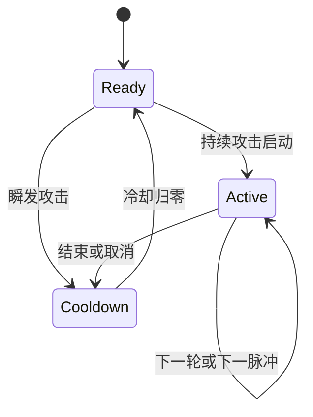

# 04 · 战斗状态、狙击武器与表现

适用规则：v1.22，2026-11-04，数值版本6。本文解释当前实现，配合前三篇的架构、武器和客户端说明阅读。

## 1. 状态的归属与执行顺序

| 状态 | 所属结构 | 写入/读取位置 |
|---|---|---|
| damageScale | AttrSet，默认1 | 卡片管线维护伤害乘区；狂暴临时乘区在 combatAttrs 中补入 |
| sniperPower | AttrSet，默认0 | 动能狙击等级；切换武器后专精暂停，购买记录仍保留 |
| shieldDisabledTicks | Actor，可选，默认0 | 巢穴雷命中写入，updateTimers每tick递减，保存和联网携带 |
| homingStartSpeed | Projectile | 发射时记录追踪初速，贯穿推进同步放大 |
| homingRecoveryDistance | Projectile | 发射时记录初始射程的50%，后续增程不延长恢复路程 |
| homingDistance | Projectile | updateProjectiles逐段累计实际路径 |
| impactPerSpeed / impactScale | Projectile | 发射时快照动能折算系数、所有伤害倍率；反射同步放大倍率 |
| stowed / shieldDisabledSeconds | ActorView | toSnapshot派生，只供画面使用，不反写World |
| rangeLeft | ProjectileView | 剩余绝对路径距离，用于区分初始短程与长程弹 |

角色和弹丸字段定义见 [world.ts](../../src/core/world.ts)，属性默认值见 [attrs.ts](../../src/core/attrs.ts)。[serialization.ts](../../src/core/serialization.ts) 校验新增数值；hashWorld自动遍历战斗字段，拖尾等装饰字段不进入哈希。

同一tick先收集意图，再更新计时器、移动和武器。持续攻击状态可阻止脱战计数；伤害发生在后续命中结算阶段并重置计数。因此本tick刚受伤会立即取消快照中的收枪状态，下一tick移动也恢复战斗速度。

## 2. 脱战、收枪与移动速度

[combat.ts](../../src/core/combat.ts) 导出统一的 `isAttacking`、`isOutOfCombat`：

- 攻击意图包括fire、placeMine，持续攻击包括laserTicks>0、burstRemaining>0。
- `outOfCombatTicks >= 180` 且没有上述攻击状态时脱战。
- 未受伤且没有攻击时，updateTimers累计计数；受到有效伤害或巢穴雷禁盾时清零。
- combatAttrs返回临时有效属性，不修改永久attrs。

狙击专精n级的战斗速度为永久管线计算结果，其中包含0.7ⁿ。脱战速度：

$$v_{travel}=v_{resolved}/0.7^n\times1.1.$$

其他移速卡、冲刺和电伤减速保留。普通弹芯枪/电弧/激光也会收枪，但没有狙击旅行加速。

[snapshot.ts](../../src/core/snapshot.ts) 输出stowed，Canvas渲染器将武器缩小、转至角色侧后方，并隐藏本地瞄准线。开始攻击或受到伤害后重新展开；HUD显示已收枪或禁盾时间。此行为不通过DOM计时器或鼠标位置推测。

## 3. 狙击武器与专精

[content/cards.ts](../../src/content/cards.ts) 定义：

| 卡片ID | 首价/优先级 | 当前效果 |
|---|---|---|
| precision-stance（狙击手） | 36 / 92 | 单级，weapon=3；伤害×2、射程×2、弹速×3，自有弹丸最多1颗 |
| sniper-specialty（动能狙击） | 48 / 120 | 需狙击手；n级伤害×2ⁿ、攻速×0.5ⁿ、战斗移速×0.7ⁿ，命中速度折算0.01n基础伤害 |

武器卡与电弧、激光两向互斥。普通购买和测试场等级设置均检查互斥；先出售当前武器再切换。专精本身可重复升级，价格使用同一1.5增长函数，不设人工等级上限；超出有限数值范围的构筑会被拒绝。

连发、霰弹在优先级110识别一弹限制，各自变成伤害×(1+0.1×该卡等级)，不再产生原弹数与代价。发弹、破片和夺回弹仍执行同一容量约束。

### 3.1 为什么要记录damageScale

枪械平加伤害在优先级10发生，后续重炮、玻璃大炮、狙击、连发转换等执行乘法。若仅把弹速伤害加到最终damage，动能部分就吃不到这些乘区；再次乘整个damage又会重复放大原伤害。

formulaCard对damage的multiply/divide操作同步维护damageScale；平加伤害不改变damageScale。狂暴在combatAttrs中同时放大damage和damageScale。发射时写入弹丸impactScale，命中公式为：

$$D_{hit}=D_{projectile}+\|vel_{hit}\|\times0.01n\times impactScale.$$

等价于“基础伤害加动能基础伤害，再经过所有乘区”。命中时从弹丸当下vel计算，追踪恢复、贯穿加速与力场都能改变它。雷场目前通过除数改变实际位移，未永久修改vel；这里使用弹丸本身的速度向量。随后才执行核心倍率、格挡、护甲与元素抗性。

[systems/hits.ts](../../src/core/systems/hits.ts) 的impactDamage集中计算直击和裂晶溅射；反射在hits/deflectField中同时调整impactScale，不能只改原damage。

## 4. 追踪按路径恢复初速

[systems/weapons.ts](../../src/core/systems/weapons.ts) 发射新追踪弹时：

$$v_0=0.5v_{base},\quad L_{recover}=0.5R_{initial}.$$

[systems/projectiles.ts](../../src/core/systems/projectiles.ts) 每段记录实际经过的路程s，转向仍采用角速度限制；段末速度恢复为：

$$v=v_0+(v_{cruise}-v_0)\min(1,s/L_{recover}).$$

转弯、弹射路段均计入，雷场只累计减速后的真实路径。贯穿推进增加射程时不会重新计算初始半程，且同步放大初速和巡航速度。旧存档中已经飞出的弹丸没有这些字段时，保留旧的时间加速分支；新发射弹丸始终使用距离规则。

## 5. 整次攻击与普攻冷却

[updateWeapons](../../src/core/systems/weapons.ts) 使用burstRemaining与laserTicks判断一次攻击是否还在执行，不另设与它们重复的待冷却状态。

持续期间fireCooldownTicks保持0，只有最后一轮/最后一tick调用startCooldown。Snapshot在持续期间展示未就绪状态，避免把0误画成已回充。实体连发每4tick一轮；激光持续12×连发轮数tick，每6tick结算一次脉冲。基础周期近似为持续时间加60/fireRate tick；瞬发电弧和单颗实体弹仍立即进入冷却。

自动开火无目标取消持续攻击，也启动完整冷却；切换武器通过reapplyAttrs结束持续状态并保留原攻击的冷却，防止换装清空等待。

## 6. 巢母弹幕与禁盾

[weaverRules.ts](../../src/core/weaverRules.ts) 集中定义常量，[systems/weaver.ts](../../src/core/systems/weaver.ts) 执行AI与发弹。

- 三波、波间60tick；每波原13方向各发三层，速度系数0.72、1、1.28，合计39颗。
- 三层共享波的朝向与停步窗口，速度差使弹幕逐渐分层。
- 巢穴工蛛雷侦测半径180、母巢雷乘1.5为270；总引信42tick，即0.7秒。
- [systems/mines.ts](../../src/core/systems/mines.ts) 对带nestRole的雷传递shieldDisruptTicks=3600。
- [applyDamage](../../src/core/systems/damage.ts) 先检查无敌，再清空盾并刷新60秒禁盾，之后结算伤害；完全格挡可阻止伤害但不解除这次禁盾。
- 禁盾不穿墙；仍受巢穴雷已有视线检查限制。普通玩家地雷不具有该效果。

盾的唯一补充路径为updateTimers中的脱战自然恢复。棱光护盾每级提供2/秒，护盾回充每级额外3/秒；购买只提高容量与速率，不即时给盾。shieldSteal字段仅为旧格式兼容保留，不再参与伤害吸取。复活、测试恢复和重新加入均不给即时盾。

## 7. 子弹与UI的表现数据

[weaponPalette.ts](../../src/render/canvas2d/weaponPalette.ts) 统一实体弹、电弧、激光的色系。子弹能量取：

$$e=\min(\text{rangeRatio},\text{rangeLeft}/700).$$

因此同为初始100%射程的短程弹也显得较弱。颜色饱和度18+78e、亮度94−23e、透明度0.16+0.84√e：能量减少时变浅、低饱和、透明，而不是发黑。敌我仍使用不同色相。

[renderer.ts](../../src/render/canvas2d/renderer.ts) 绘制实心圆壳、小型热核和有限光晕；尾焰从弹体半径逐步收尖，长度取实际速度×0.12、最多190。沿已有trail构造两侧边界，转弯时跟随真实轨迹，不把低速弹画成长条。

升级目录在[sections/cards.ts](../../src/ui/sections/cards.ts)中按选中分类过滤内容；sessionStorage分别保存prism.cardCategory与prism.cardFilter。收藏、预购、出售、测试等级控件沿用同一卡片组件。桌面目录在左侧，720px及以下改为上方横向滚动，无分类details折叠。

[sections/keys.ts](../../src/ui/sections/keys.ts) 每个功能一行，左标签、右绑定按钮；按键捕获、冲突拒绝和自动持久化仍由bindings.ts处理。

## 8. 旧文件与联网版本

[legacyCardsV5.ts](../../src/content/legacyCardsV5.ts) 冻结旧卡表。导入先补新属性默认值，再按对应旧卡表验证，最后迁移，不能直接把旧attrs重算成合法。单人支持V1–V5与当前V6，合作支持旧V5与当前V6。

[cardMigrations.ts](../../src/app/cardMigrations.ts) 对旧狙击n级：第一份实付留在单级武器，余下n−1份转为专精。若与旧能量武器共存，保留能量武器、退还全部狙击实付的60%；移除的吸盾卡也逐级按实付60%退款，缺paid时用冻结旧价补账。

收藏删除吸盾ID；有序预设把重复狙击里程碑拆成武器与专精，已经完成的里程碑不重复购买。房间资源、随机状态、已在飞的弹丸及保存名称/时间保留。合作对每个席位独立迁移，最终Boss索引从关卡列表长度推导，接受25、拒绝26。

数值版本6与文件格式v1是两套标记。实时协议为DUEL_PROTOCOL=8、prism-coop-2，参与者应刷新至同一版本。

## 9. 验证入口

[tests/unit/sniperCombat.test.ts](../../tests/unit/sniperCombat.test.ts)覆盖狙击互斥、速度伤害乘区、旅行速度、持续攻击冷却、雷场内半程恢复、真实巢穴雷禁盾、护盾唯一恢复路线、旧文件/预设及合作席位迁移。现有ballistics/weaver/progression等用例同步检查新规则。

自动测试验证数值和状态；视觉密度、收枪方向、目录与移动端溢出仍需通过实际构建页面检查。单机引擎/编解码测试不代表五设备真实网络验收。
