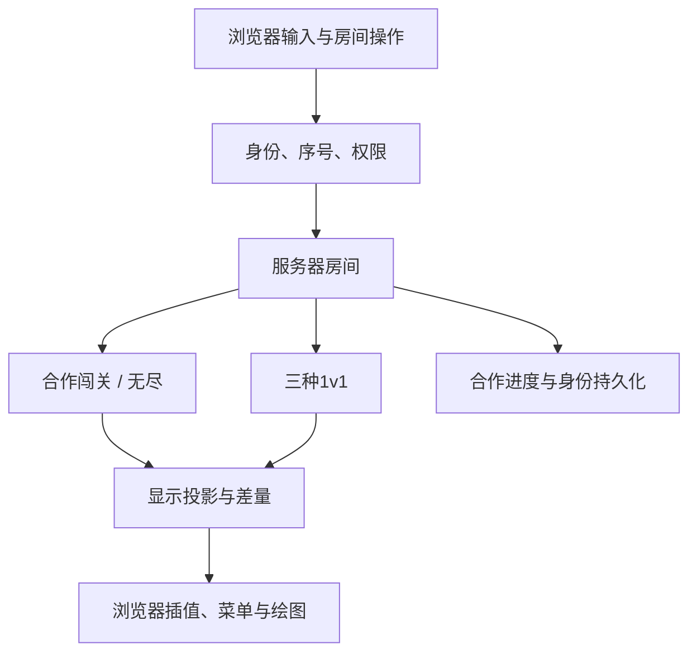

# 05 · 权威服务器、身份与显示差量

当前实现：v1.23，2026-11-04。数值存档版本仍为6，实时协议为 `prism-server-1`。玩家运行说明见[服务器指南](../server-guide.md)。此前手工信令、RTC通道与浏览器房主模拟已经移除，本篇描述现在的实现。

## 1. 模块边界

| 文件 | 责任 |
|---|---|
| [server/main.ts](../../src/server/main.ts) | 环境变量、启动信息、退出保存 |
| [server/server.ts](../../src/server/server.ts) | HTTP/WS、连接身份、命令调度、定时器、广播、背压与来源检查 |
| [server/rooms.ts](../../src/server/rooms.ts) | 房间配置、席位、权限、模式适配、导入恢复 |
| [server/store.ts](../../src/server/store.ts) | 稳定ID、凭证哈希、密码KDF、串行原子写入 |
| [server/discovery.ts](../../src/server/discovery.ts) | UDP多播响应、临时查询socket、LAN地址 |
| [net/serverProtocol.ts](../../src/net/serverProtocol.ts) | 类型、JSON预算、命令解码、地址归一化 |
| [net/control.ts](../../src/net/control.ts) | 输入清洗、边沿事件累积与过期 |
| [net/sync.ts](../../src/net/sync.ts) | 投影、字段字典、差量、关键帧、显示插值、尾迹 |
| [app/serverSession.ts](../../src/app/serverSession.ts) | 浏览器连接、身份备份、房间大厅、管理、菜单与输入 |
| [storage/clientId.ts](../../src/storage/clientId.ts) | 非HTTPS局域网页面也可使用的随机请求ID |

服务器复用 `createCoopMatch` / `createDuelMatch` 与纯core，不复制一套伤害公式。浏览器不调用联机step、不接收远程World、不恢复远程存档以绘图。单人游戏仍使用本地World。

## 2. 两类ID与凭证

- **用户ID**：随机 `P-UUID`，同一服务器跨连接保持稳定，公开显示用于管理。
- **角色ID**：已有World实体整数，只在当前房间/模式中有意义。合作角色不一定是1–5，入场资源也使用同一ID分配器。
- **私有凭证**：32字节随机值编码为base64url，签发时返回一次，之后由客户端提交；服务器存SHA-256哈希。
- **serverId**：持久化UUID，用于识别同一地址是否已更换服务器数据库。

客户端身份按服务器origin存储，避免发现回应伪造serverId后自动获得另一个地址的凭证。换地址/设备需要明确导入身份备份。公开ID、显示名、角色整数都不能作为身份认证。

一个身份同时只保留一条活动连接，新连接替换旧连接，旧连接以4001关闭；旧页面停止重连。关闭回调检查连接仍是byUser映射中的当前对象，避免旧socket关闭把新会话也标离线。

账号密码体系尚未引入；这套凭证身份定位于私人朋友服务器。正式公开运营可以在hello之前接入外部账号，再沿用现有房间权限。

## 3. 建房、成员与权限

`Room`保存id、options（不含明文密码）、密码KDF、ownerId、members、banned、epoch、活动时间与模式实例。`RoomMember`把userId绑定到actorId，并记录owner/moderator/player与在线/准备状态。

创建房间默认检查建房授权码、每ID一间房、全服房间数上限。密码使用随机盐与scrypt；网络处理使用异步KDF，避免密码验证阻塞60Hz循环。所有命令在每连接队列中有序处理。

`authorize`验证连接成员、目标房间与epoch，再验证角色；分配管理员、转让和关闭只能由房主操作。管理员不能管理房主或其他管理员。购买永远使用连接绑定的actorId，不信任客户端额外提交的钱包或属性。

房主是管理者，不是模拟宿主。离线60秒后，管理权可交给在线成员；主动离开立即交接。移除原先的合作引擎host角色时，模式内部hostId也移交，确保后续存档仍引用一个存在的席位。

公开房间进入列表，未公开房间只对已有成员列出；其他人需要房间ID。房间密码与建房授权码是不同的权限。封禁按userId保存，免注册身份不提供强实名封禁。

## 4. 操作序号、重试和重连

客户端消息分为hello、input、command、ping。输入含roomId、epoch、sequence、意图和offers可见性；command带requestId。

- 输入只接受当前房间与epoch，sequence递增；方向归一化，未知属性丢弃。
- `createRemoteInput`合并尚未消费的skills与锁定边沿，读取后清除；移动/开火等保持到350ms超时。
- 客户端最多30Hz输入，未变化时100ms心跳；隐藏页面立即发送空输入，服务器无需依赖该事件也能超时清空。
- 命令按身份/requestId缓存近期结果，重复发送同一购买不会重复扣款。连接替换期间的异步建房/加入在KDF后再检查活动连接。
- epoch在创建/进程恢复时使用随机起点，重开、切合作房间、进入新PVP回合时递增；旧购买/输入不能在新代次重放。
- 断线按1、2、4、8秒上限退避重连，恢复原身份和席位；待确认命令使用原requestId重发。进程重启后旧epoch会被拒绝，需要依据新快照重新操作。

服务器使用WS ping与应用ping，20秒无响应终止连接。合作是否暂停遵从配置；1v1缺少选手时停止推进，超过60秒按弃权处理。全部离线时不推进World。

## 5. PlayState不是存档

`playState`只包含：

1. `toSnapshot`生成的只读显示数据。
2. 当前玩家的精确attrs、购买账目、预购与通知。
3. 已拥有技能、当前模式限制与暂停/进度标签。
4. 1v1公开比分、阶段与时间，省略双方完整plans/notices，只单独发送自己的计划。

不发送随机数内部状态、导航路径、未来刷怪、命中历史、服务器权限凭证或其他玩家私有购买计划。卡片名称/描述/价格函数由客户端同版本卡表生成，不随每个快照反复发送55张卡的文案。

`listBuildCards`从registry、attrs、purchases、shards、restrictions生成菜单，不必构造一个假的World。它与单人listCardStates复用同一实现，出售价格仍按真实paid账目。

## 6. 传输结构与基线

固定字典把ActorView、ProjectileView、MineView、Pickup的字段映射到数组下标，避免逐实体重复键名。字典由协议版本约定，两端代码一致。

`SyncFrame`包含serial、base、key、meta与四个实体组。每组有：

| 字段 | 含义 |
|---|---|
| up | 新增或变化较密集的完整数组行 |
| patch | `[id, 字段下标, 值, ...]` |
| gone | 删除的实体ID |

meta仅发送变化的顶层值，例如地图、自己构筑、比分、效果等。角色稳定属性、地图和障碍物无需每帧广播。每5秒完整关键帧，连接或room epoch变化也重置基线。收到缺少base的差量时客户端请求resync，不把不完整世界当成正常游戏继续。

私有属性、购买账目与棱晶保留精确数值，避免量化导致“看起来买得起、实际上差一点”的错误；位置、计时、射程光效等显示数据保留0.001精度。服务器模拟数据未量化。

WebSocket采用permessage-deflate，阈值512字节、level3、双方不保留压缩上下文，最多5个并发压缩任务。每连接待发送量超过128KiB时跳过追加快照，并保留未发送前的基线。连接内有序可靠传输，重连必须重新关键帧，不复用失效队列。

## 7. 显示插值与瞬时事件

`createSnapshotInterpolator`保存前后两次Snapshot，按30–150ms插值，通常相当于一个100ms网络间隔。角度采用最短圆周差，防止跨±π时绕远。房间变化、tick倒退或明显传送时不缓慢拖动角色。

弹丸线上不带trail，客户端用插值后的实际位置重建最多12点尾迹。子弹速度、剩余射程、伤害类型和power仍存在，因此原来的能量配色和锥形尾焰继续生效。

effects/floaters每帧最多各64个；能量trace沿用Snapshot有界数组。非常短命、在两次网络采样之间已消失的弹丸可能不显示完整飞行过程，命中伤害仍由服务器精确执行。当前没有客户端预测、回滚、PvP延迟补偿或完整事件日志流；它们是后续可独立扩展的表现层工作。

## 8. 持久化与旧存档

`.prism-server/server.json`存身份哈希、服务器ID、建房码和合作房间。写入先串行写临时文件，再rename；一个写入失败不会使后续写入队列永远拒绝。health接口可报告persistence=error，终端给出保存失败信息。

合作存储同时保存CoopSave、ID角色绑定、权限、密码哈希与封禁；恢复时全部离线、暂停，等原身份加入。没有把公网用户凭公开ID映射到任意旧角色。旧JSON导入由房主执行；没有身份映射的其他角色保留为unclaimed席位，仅在密码房中通过密码与可选角色编号认领。

默认10秒周期、管理操作及关闭触发保存；突然断电最多可能丢最近周期。1v1只保留进程内状态，不宣称可恢复服务端进程崩溃的比赛。

## 9. HTTP、来源与局域网

HTTP提供/api/info、/health、/api/discovery和可选静态dist。WS升级只接受/socket。主机名与Origin通过本机地址/配置公网URL/允许前端来源检查；不把任意跨站网页当成可信控制台。JSON大小、树深度、消息频率、连接和房间数量都有预算。

服务器启动不能读取网卡信息时回退到本机地址，不因此拒绝所有手动连接；自定义主机名通过PRISM_PUBLIC_URL显式配置。

局域网发现的响应socket监听UDP47873，查询使用单独临时端口以避免同机多实例共享监听端口时收错回应。每次查询用随机nonce，TTL为1，收集0.9秒；仅返回PRISM协议回应，仍须再次连接认证。

浏览器通过一个发现入口查询，不能直接接收UDP。HTTPS到LAN HTTP/WS的许可依赖浏览器；提供同版静态游戏的LAN入口作为兼容路径。公网默认禁用发现；多播跨VLAN、VPN和访客隔离网络不保证可达。

## 10. 构建与发布

`server:build`使用esbuild把Node入口打包到dist-server/server.mjs，ws保留为锁定的运行依赖。`server:package`先构建前后端，再用fflate生成ZIP，包含前端、编译后端、package/lock、启动脚本与指南，不包含数据目录。

GitHub Actions执行test、lint、server:package并发布dist，所以GitHub Pages同时提供游戏与服务器包下载。Pages不会运行后端进程。Windows启动脚本与POSIX脚本首次安装production依赖后运行已编译服务器；Docker从源码构建，持久卷独立存档。

## 11. 可重复基准与验证

`npm run bench:sync`生成5人、静态地图、0/100/500颗持续飞行弹丸的50帧样本（10Hz），比较完整合作存档消息与差量，再单独deflate压缩。2026-11-04本环境的一次结果：

| 弹丸 | 原消息平均 | 差量平均 | 压缩后平均 | 压缩后降幅 |
|---|---:|---:|---:|---:|
| 0 | 13,539 B | 304 B | 128 B | 99.1% |
| 100 | 75,254 B | 4,610 B | 1,366 B | 98.2% |
| 500 | 323,255 B | 22,254 B | 6,689 B | 97.9% |

500弹样本单客户端每网络帧编码约1.45ms、解码约1.12ms；向4个客户端10Hz发送压缩数据约2.14Mbps；服务器向全部5个客户端发送约2.68Mbps，均未计协议开销。数字随机器/动作变化，不能外推为任意无尽层或任意线路的容量保证。基准保留全部500颗弹丸在大边界内飞行，避免弹丸很快消失造成虚假的低流量。

[networkSync.test.ts](../../tests/unit/networkSync.test.ts)覆盖精确钱包、nullable字段、差量新增/删除、基线丢失恢复、多客户端隔离、插值/尾迹、流量比例与核心不变性。[server.test.ts](../../tests/unit/server.test.ts)建立真实HTTP/WebSocket连接，覆盖建房授权、密码/容量、越权、请求幂等、身份接管防护、重连、原host移除、五人进程恢复、旧存档认领与三种1v1。另有真实UDP回环测试检查发现协议及nonce；不将它当成跨设备多播验收。

本机多socket测试不等于五台物理设备联机；UDP广播、防火墙、移动浏览器后台行为和目标地区线路仍需在实际使用网络验收。
