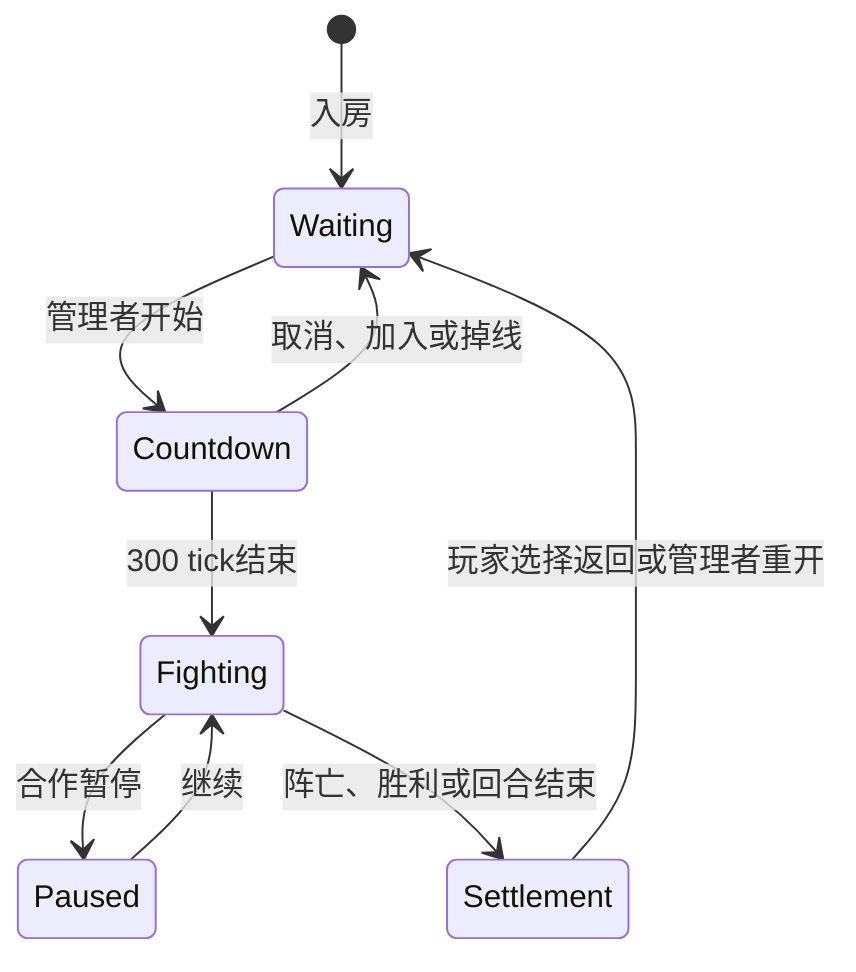

# 06 · 等待大厅、倒计时、结算与服务器运维

适用v1.24，2026-11-05；数值存档版本6，实时协议prism-server-2。操作说明见[服务器指南](../server-guide.md)。

## 状态与所有权

| 状态 | 执行位置 | 数据 |
|---|---|---|
| 服务器连接/房间列表 | app/serverSession + server/server | 用户ID、连接、房间成员及权限 |
| 等待大厅 | server/waiting | 独立World、RNG、靶机、训练弹丸与技能冷却 |
| 开局倒计时 | server/rooms.tickRoom | startTicks，300→0；仅在线房间推进 |
| 正式对局 | app/modes/coop或duel | 真实World、钱包、构筑、关卡、随机数和存档 |
| 结算界面 | app/serverSession.showSettlement | 从权威结束状态生成DOM；玩家选择导航 |

`isWaiting`根据合作started或1v1的preparing/round-over阶段计算，不能由客户端提交。RoomInfo和PlayState提供waiting、startCountdown（向上取整秒数）。成员进入后直接就绪，没有ready/cancel-ready网络命令。模式内部的ready方法保留用于原有模式测试与内部编排，不暴露手动准备UI。

其中1v1回合结束后台可生成下一回合等待世界，浏览器仍保留结算界面直到玩家选择；合作重开才重置失败的正式世界。图中的Settlement是客户端呈现状态，不会自行把正式失败局转换成可退全款的等待状态。

## 独立训练世界

[waiting.ts](../../src/server/waiting.ts)通过createWaitingArena建立独立2000×1300训练场，提供0/20/60护甲的三只靶机。所有房间成员在训练场暂为同阵营，角色ID沿用正式席位；靶机、弹丸使用独立较高ID空间。靶机死亡后恢复，玩家训练时免伤。

每次sync从正式World复制成员属性、技能槽和构筑账目；step只作用于训练World。训练钱包是副本，step后以正式余额覆盖，掉落清理，经济率为零。正式World、随机数、战绩和CoopSave保持不变。主武器和技能继续使用同一core实现，未复制另一套武器规则。

购买、装备和计划操作直接作用于模式持有的正式构筑，训练世界下一次sync映射新的属性。因此保留购买结果不需要“把训练世界倒灌回正式世界”。正式开始丢弃训练World，模式正常初始化关卡与位置；输入缓存清空，epoch递增，客户端重建关键帧和输入序号。训练弹丸、地雷、临时增益和冷却不会带入战斗。

[rooms.ts](../../src/server/rooms.ts)的visibleWorld/playState只在等待阶段选择训练世界。storedRoom始终调用正式合作引擎save；服务器重启不会恢复一半进行的倒计时或训练弹丸。

## 开始与退款

scheduleStart由权限检查后的服务器命令或本机终端调用。首次等待阶段设300tick；重复点击拒绝，不延长计时。tickRoom每固定步减少1，减到零时调用合作start或1v1 start，再清理训练世界、更新epoch。1v1不再额外叠加模式内部原3秒倒计时。暂停中的合作start只是继续，不重新获得训练退款资格。

参与者成功加入、离开或掉线会取消倒计时；被拒绝的加入不得取消已有倒计时。房主或管理员可以cancel-start。倒计时期间仍可移动、测试和原价调整构筑，正式开始的边界由服务器单线程执行顺序决定。

[progress.ts](../../src/core/progress.ts)的listBuildCards/saleValue/sellCard接受可信调用方传入refundRatio；默认仍为0.6，等待阶段服务器指定1。金额取购买账目最后一级paid，缺省才取对应旧价格规则的现有补齐值。全额退款不执行原“至少损失1”限制；正式对局沿用向下取整及至少损失1。客户端没有权利提交退款倍率。

CardsSectionState的refundRatio用于介绍文案，单卡refund由同一函数生成；阶段改变强制刷新菜单，即使钱包和构筑相同，也不保留大厅100%的旧显示。固定装备1v1仍拒绝购卡和出售。

## 浏览器交互与结算

[serverSession.ts](../../src/app/serverSession.ts)入房自动隐藏管理表单、进入训练场；管理按钮可随时打开房间页。HUD显示等待规则、服务器倒计时或正式暂停提示。隐藏表单失焦，避免键盘仍输入看不见的表单。开始/重开时清输入和同步基线。

结束状态从同步包检测，showSettlement保留Canvas战场并显示结果、击杀、时间与棱晶。查看战场、返回房间、管理者重开是显式按钮操作；结束包不再强制打开连接大厅。菜单、隐藏标签页和结算弹层抑制本人的移动/开火输入，关闭菜单不会把旧按键重新按住。

[serverSession.test.ts](../../tests/unit/serverSession.test.ts)使用Happy DOM加载真实客户端装配、键盘、鼠标与触控逻辑，控制WS消息和显示帧。它验证大厅输入、双摇杆、倒计时、退款显示、菜单/后台和结算导航；不等价于五台浏览器跨网络实测。

## 配置、日志与终端

| 实现 | 责任 |
|---|---|
| [config.ts](../../src/server/config.ts) | JSON/env/default优先级、路径、类型、范围、来源校验 |
| [logger.ts](../../src/server/logger.ts) | 日志级别、字段脱敏、终端安全文本、串行写入、轮转和退出刷新 |
| [console.ts](../../src/server/console.ts) | 本机命令语法与帮助；拒绝未知命令/错误参数数目 |
| [server.ts](../../src/server/server.ts) | 事件、计数、inspectPlayer/status/admin及已有权限边界 |
| [main.ts](../../src/server/main.ts) | 配置装配、终端stdin、启动信息、信号退出 |

日志使用time/level/event及上下文字段，禁止身份token、房间password、授权key和hash等字段明文进入文件。终端清理控制字符。默认5MiB×活动文件及5份历史轮转，待写队列最多1024条，拥塞丢弃计数随后记录；日志写入失败在终端报告，不阻塞模拟。

默认info记录关键连接、身份、房间和阶段事件，debug增加成功命令细节。操作异常包含房间、用户与连接ID；输入拒绝做连接级节流，输入成功只记录首次接收，计数和最新状态用input命令按需查询。status的发送字节是压缩前JSON应用层计数。

admin只由Node本机stdin调用，没有HTTP/WS管理员路由；网络命令仍校验身份、角色、房间和epoch。终端有完整服务器管理权限，执行种类和目标写日志，但不记录任意原始终端行。stop保存失败会保持进程，正常退出等待服务器保存及日志队列刷新。绑定端口失败清理已建立的定时器和发现socket，避免报错后仍挂住进程。

## 验证

新增真实WebSocket测试覆盖五人等待大厅移动/开火、正式世界不变、逐级原价退款、正式暂停不能全额退款、300tick开局边界、加入/掉线取消、旧代次拒绝、新输入生效与超时、终端查询和管理及日志不泄露身份。配置/日志测试覆盖优先级、错误输入、目录、轮转、级别、脱敏和命令解析。原有模式与战斗测试继续保留。
